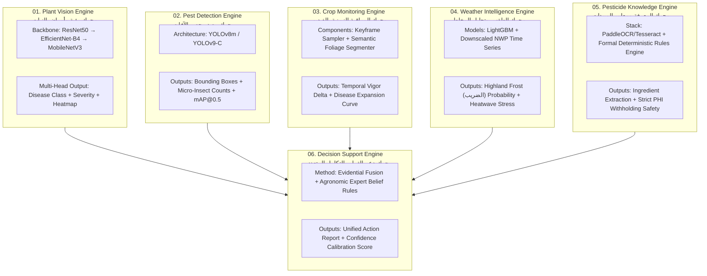
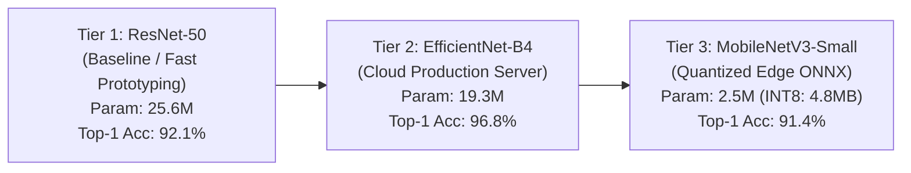
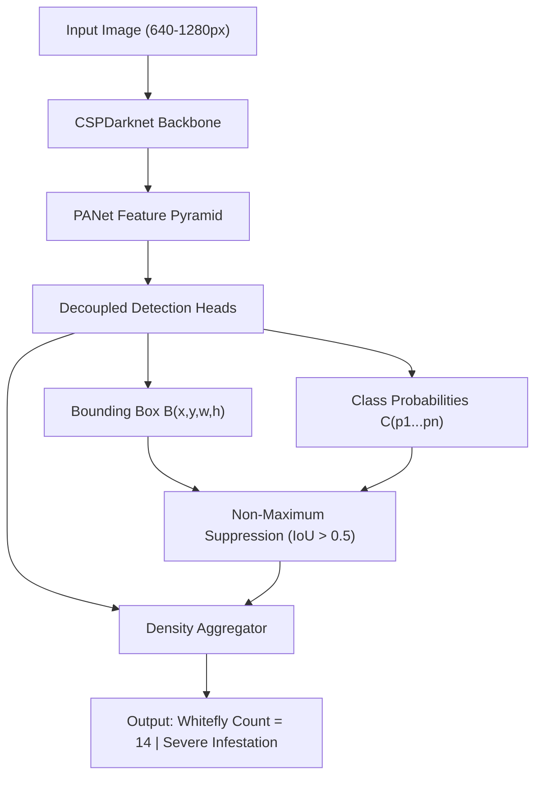
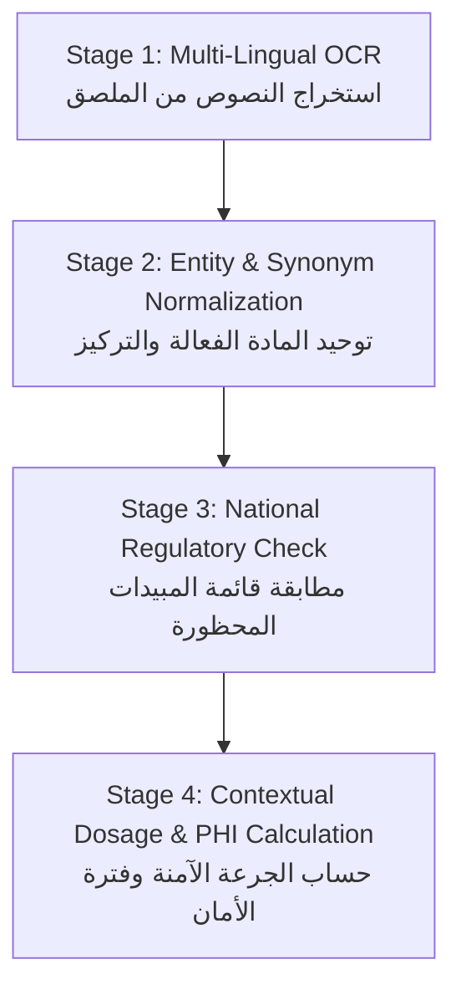
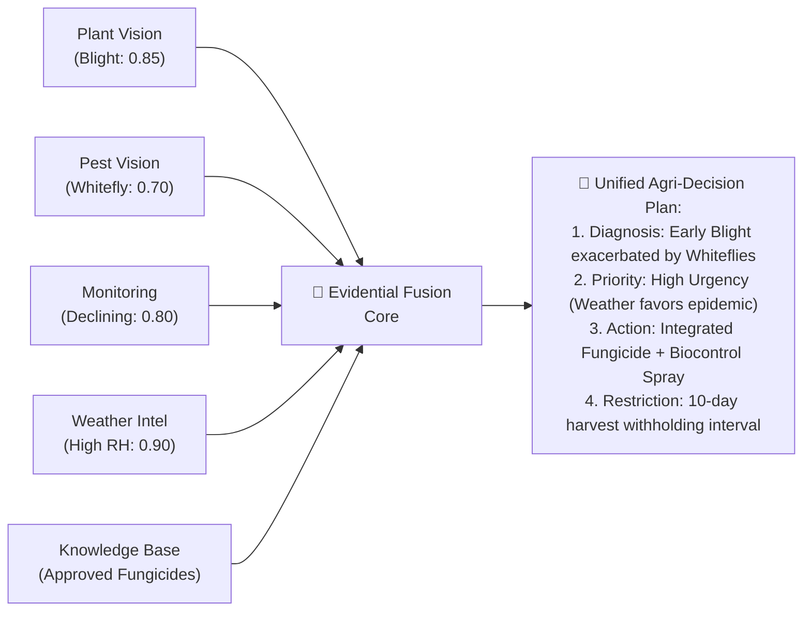

# AI Engines Specification / المواصفات الهندسية لمحركات الذكاء الاصطناعي

> **Document Version:** 1.0  
> **Status:** Approved / معتمد  
> **Reference:** [Foundation Document](../architecture/foundation-document.md) · [System Overview](../architecture/system-overview.md)

---

## 1. Engine Suite Architecture / المعمارية الشاملة للمحركات الستة

AgriVision AI is powered by six decoupled, specialized AI engines that orchestrate multi-modal reasoning across visual, temporal, physical, and regulatory inputs:

---

## 2. Engine 01: Plant Vision Engine (محرك رؤية النبات)

### 2.1 Architectural Progression & Evolution Strategy
The Plant Vision Engine evolves through a rigorous 3-tier architectural progression ensuring fast benchmarking, maximum server accuracy, and ultra-compact mobile deployment:

1. **Tier 1 — ResNet-50 (Baseline Benchmark):**
   - Established as the experimental anchor. Fast convergence, well-understood gradient flow via residual connections, ideal for rapid exploratory data analysis.
2. **Tier 2 — EfficientNet-B4 (Cloud Production Master):**
   - Compound scaling balancing depth, width, and input resolution ($380 \times 380$).
   - Features Squeeze-and-Excitation (SE) blocks that dynamically emphasize subtle fungal lesion textures over flat leaf blade surfaces.
3. **Tier 3 — MobileNetV3-Small (Quantized Edge Master):**
   - Employs hardware-aware Neural Architecture Search (NAS) and hard-swish non-linearities.
   - Post-training INT8 quantization yields an ultralight $4.8\text{ MB}$ payload running sub-180ms on low-cost ARM Cortex processors.

### 2.2 Multi-Task Loss Formulation
The production model utilizes a compound loss combining classification cross-entropy with focal weighting for imbalanced classes:
$$\mathcal{L}_{\text{total}} = \alpha \mathcal{L}_{\text{Focal}}(\hat{y}_{\text{pathogen}}, y) + \beta \mathcal{L}_{\text{BCE}}(\hat{y}_{\text{healthy}}, y_{\text{healthy}}) + \gamma \mathcal{L}_{\text{SmoothL1}}(\hat{s}_{\text{severity}}, s)$$
Where $\alpha=1.0, \beta=0.5, \gamma=0.3$.

---

## 3. Engine 02: Pest Detection Engine (محرك اكتشاف الآفات)

### 3.1 Neural Architecture & Optimization
- **Backbone & Neck:** YOLOv8-Medium utilizing CSPDarknet53 feature extraction with a Path Aggregation Network (PANet) neck to preserve fine-grained spatial features necessary for small arthropod detection.
- **Input Resolutions:** Multi-scale training between $640 \times 640$ and $1280 \times 1280$ pixels to ensure whiteflies ($1\text{ mm}$) and armyworm caterpillars ($40\text{ mm}$) are simultaneously recognized.

### 3.2 Evaluation Metrics & Targets
- **mAP@0.5:** Target $\ge 88.5\%$ across major economic insect orders.
- **mAP@0.5:0.95:** Target $\ge 64.0\%$ ensuring high spatial precision.
- **Inference Latency:** $< 45\text{ ms}$ on NVIDIA T4 GPU; $< 1800\text{ ms}$ on server multi-core CPU.

---

## 4. Engine 03: Crop Monitoring Engine (محرك المراقبة الزمنية)

### 4.1 Frame Selection & Temporal Processing Pipeline
1. **Dynamic Frame Sub-Sampling:**
   - Video streams undergo frame differencing and optical flow evaluation ($L_2$ norm of Farnebäck dense flow).
   - Frames with severe camera jitter or rotational blur ($\text{Blur Metric} > 0.65$) are rejected automatically.
   - Selected candidate keyframes are extracted at spatial intervals equivalent to $1.5 - 2.0\text{ meters}$ of ground distance.
2. **Canopy Semantic Segmentation:**
   - Lightweight DeepLabV3+ with MobileNetV2 backbone generates pixel masks segmenting crop foliage from bare soil, drip lines, and rocks.
3. **Temporal Change Detection Algorithm:**
   - Aligns multi-visit vegetative indexes across chronological intervals $t_0, t_1$:
     $$\Delta \text{Vigor} = \text{GLI}(t_1) - \text{GLI}(t_0)$$
   - Rapid negative drops ($\Delta \text{Vigor} < -0.15$) alert the system to root rots, water stress, or early pest infestations before leaf drop.

---

## 5. Engine 04: Weather Intelligence Engine (محرك الطقس الذكي)

### 5.1 Physics-Informed Microclimate Modeling
Integrates regional numerical weather predictions (ECMWF, GFS) with high-resolution Digital Elevation Models (DEM) of Yemen's mountainous terrain to correct for adiabatic lapse rates ($-6.5^\circ\text{C}$ per $1,000\text{ m}$ elevation gain).

### 5.2 Highland Radiation Frost Prediction (تنبؤ الضريب)
- **Model:** Gradient-Boosted Decision Trees (LightGBM) trained on historical meteorological records from Dhamar, Sana'a, and Amran highland stations.
- **Input Feature Vector:**
  $$X = [T_{\text{ambient}}, T_{\text{dew}}, RH, \text{WindSpeed}, \text{CloudCover}, \text{Elevation}, \text{DayOfYear}, \text{CoolingRate}_{3\text{hrs}}]$$
- **Performance Threshold:**
  - Recall for Frost Events: $> 94\%$ (prioritizing zero missed frost events over false positives).
  - Lead Time: 12-hour advance alert window delivered to farmers by 15:00 AST.

---

## 6. Engine 05: Pesticide Knowledge & Safety Engine (محرك المبيدات وإدارة الأمان)

### 6.1 The 4-Stage Verification & Safety Pipeline

1. **Stage 1 — Multi-Lingual OCR:** Dual-engine OCR (PaddleOCR for complex Arabic typography + Tesseract for English scientific nomenclature) extracts trade names, batch numbers, and active ingredients.
2. **Stage 2 — Entity Normalization:** Matches extracted strings against the unified international Chemical Abstracts Service (CAS) catalog and agricultural synonyms (e.g., "مانكوزيب", "Mancozeb", "ديضان").
3. **Stage 3 — Regulatory Enforcement:**
   - Hardcoded database check against Yemeni Ministerial Decrees regarding prohibited chemicals.
   - Automatic hard-stop trigger if chemical belongs to the **Rotterdam Convention Dirty Dozen** (e.g., Methamidophos, Monocrotophos, Endosulfan).
4. **Stage 4 — Dosage & Safety Period Calculator:**
   - Calculates volumetric mixing proportions matching the farmer's equipment.
   - Enforces strict **Pre-Harvest Interval (PHI)** constraints, generating explicit harvest bans.

### 6.2 Non-Negotiable Safety Constraints / ضوابط الأمان الإلزامية
> [!CAUTION]
> 1. **No Hallucinated Dosages:** Under no circumstances shall an LLM or probabilistic neural model predict chemical dosage quantities. All dosages are derived from deterministic relational lookup tables verified by agronomists.
> 2. **Prohibited Chemical Red Alert:** If a scanned pesticide is banned, the engine overrides all UI flows with an un-dismissible red hazard screen warning of carcinogenicity, acute toxicity, and legal prohibition.
> 3. **Mandatory Personal Protective Equipment (PPE):** Every recommendation includes mandatory Arabic pictograms indicating gloves, respirators, and eye protection requirements.

---

## 7. Engine 06: Decision Support & Evidential Fusion Engine (محرك دعم القرار)

The Decision Support Engine synthesizes outputs from Engines 01–05 using Dempster-Shafer evidential reasoning combined with agronomic heuristic trees:

- Generates human-interpretable rationale for every recommendation.
- Provides calibrated confidence bands (Low, Medium, High) preventing overconfidence on ambiguous symptoms.
- Incorporates farmer cultural constraints (organic-only preferences, available local agrochemicals).
