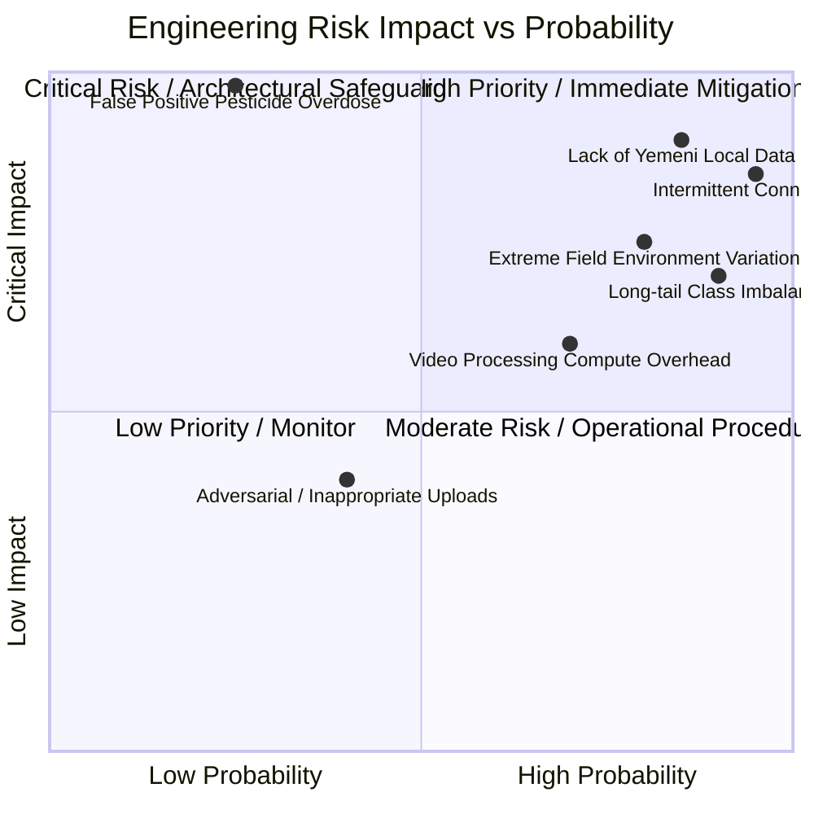

# Engineering Risks and Known Boundaries / المخاطر الهندسية والحدود التشغيلية

> **Document Version:** 1.0  
> **Status:** Approved / معتمد  
> **Reference:** [Foundation Document](../architecture/foundation-document.md) · [AI Engines](./ai-engines.md) · [Security & Privacy](../security/security-privacy.md)

---

## 1. Executive Summary / الملخص التنفيذي

Building an agricultural AI platform for Yemen involves navigating unique environmental, logistical, and computational boundaries. Documenting these engineering risks upfront prevents catastrophic failure modes, guides fallback architectures, and sets transparent performance expectations for farmers and stakeholders.

توثيق المخاطر الهندسية والحدود التشغيلية هو ركيزة أساسية لمنع الإخفاقات الميدانية وبناء معماريات احتياطية وضمان سلامة المحاصيل والمزارعين.

---

## 2. Risk Matrix Overview / مصفوفة المخاطر الشاملة

---

## 3. Deep-Dive Risk Analysis & Mitigation Strategies

### 3.1 Risk 01: Severe Scarcity of Yemeni Local Training Data
- **Problem Statement:** Public agricultural computer vision datasets (PlantVillage, PlantDoc) feature foreign cultivars, artificial lighting, or temperate climates. Yemeni endemic cultivars (e.g., local coffee varieties *Udaini*, *Dawairi*, or regional grapes *Raziqi*, *Aswad*) exhibit distinct foliage textures and pigmentation.
- **Technical Consequences:** High misclassification rates, failure to distinguish endemic viral strains, poor generalization under intense equatorial sunlight.
- **Architectural Safeguards:**
  1. *Transfer Learning from In-The-Wild Benchmarks:* Pre-train backbones on noisy field data (PlantDoc, iNaturalist) rather than sterile lab benchmarks.
  2. *Active Field Data Campaigns:* Institutional partnerships with Yemeni Agricultural Research Stations (ذمار والحديدة) to capture and annotate gold-standard local samples.
  3. *Strict Class Gating:* The system explicitly refuses to diagnose any crop or disease that lacks at least 500 validated local field samples.

### 3.2 Risk 02: Severe Environmental & Illumination Variation
- **Problem Statement:** Images captured in Yemen range from blazing noon sunlight in Tihama coastal plains ($> 100,000\text{ lux}$) to shadowed terraced mountains in Taiz and Ibb, along with pervasive airborne dust and lens contamination.
- **Technical Consequences:** Specular glare washing out fungal lesions; dust particles mimicking powdery mildew or spider mite damage.
- **Architectural Safeguards:**
  1. *On-Device Illumination & Blur Filtering:* The mobile app pre-evaluates histogram entropy and highlights blown-out pixels before inference.
  2. *Domain-Specific Augmentations:* Training pipelines utilize Albumentations to simulate intense solar flare, dust occlusion, lens vignetting, and chromatic aberration.
  3. *Multi-Angle Guidance:* The UI instructs the farmer to capture leaf undersides away from direct blinding sun.

### 3.3 Risk 03: Long-Tail Class Imbalance & Pathogen Mutation
- **Problem Statement:** Common diseases (Early Blight, Powdery Mildew) have abundant samples, whereas high-consequence emerging pathogens (e.g., specialized viral leaf curls, quarantine pests) have limited real-world captures.
- **Technical Consequences:** Standard neural networks collapse to majority class predictions, systematically missing rare but catastrophic infections.
- **Architectural Safeguards:**
  1. *Loss Function Weighting:* Implementation of Asymmetric Focal Loss ($\gamma = 2.0$) heavily penalizing false negatives on critical rare diseases.
  2. *Synthetic Data Augmentation:* Exploring controlled generative diffusion models for rare lesion synthesis on healthy leaf backdrops.
  3. *Anomaly Detection Fallbacks:* A parallel Autoencoder flags visual anomalies that diverge significantly from the "Healthy" leaf manifold, outputting "مرض غير معروف - يلزم فحص مختبري" (Unknown disease - laboratory assay required).

### 3.4 Risk 04: Poor, Intermittent & Costly 2G/3G Connectivity
- **Problem Statement:** Rural farmers in remote valleys often operate under complete network blackouts, slow 2G GPRS, or prohibitively expensive mobile data tariffs.
- **Technical Consequences:** Network timeouts, truncated image uploads, high battery drain from continuous reconnection attempts.
- **Architectural Safeguards:**
  1. *Autonomous On-Device Model:* Lightweight quantized ONNX runtime MobileNetV3 runs fully offline with zero internet requirement.
  2. *Persistent SQLite Upload Queue:* Requests are queued locally with exponential backoff and resume capabilities.
  3. *Aggressive Client-Side WebP Compression:* Images are compressed to high-efficiency WebP format ($< 150\text{ KB}$ per image) prior to transmission.

### 3.5 Risk 05: High Compute & Bandwidth Costs of Handheld Video Processing
- **Problem Statement:** Streaming raw 1080p video walkthroughs to cloud servers for crop monitoring strains network bandwidth and incurs expensive cloud GPU compute costs.
- **Technical Consequences:** System server bottlenecks during peak morning hours; costly server infrastructure bills.
- **Architectural Safeguards:**
  1. *Edge Keyframe Selection:* Video frames are sub-sampled entirely on the mobile handset; only 4–8 selected high-clarity keyframes are uploaded per row.
  2. *Asynchronous Background Processing:* Video analyses are assigned to low-priority background Celery queues, freeing up real-time server resources for instantaneous photo diagnostics.

### 3.6 Risk 06: False Positive Diagnoses & Erroneous Confidence Calibration
- **Problem Statement:** Overconfident deep learning models outputting 95% certainty on a completely incorrect diagnosis could mislead a farmer into applying expensive, unnecessary, or harmful chemical sprays.
- **Technical Consequences:** Financial loss for impoverished farmers, crop scorch, chemical resistance development, erosion of trust in the platform.
- **Architectural Safeguards:**
  1. *Mandatory Temperature Scaling Calibration:* All model logits undergo post-hoc empirical calibration ($ECE < 0.05$).
  2. *Conservative Confidence Tiers:*
     - Confidence $\ge 85\%$: "تشخيص مؤكد وموثوق" (Confident diagnosis).
     - Confidence $70\% - 84\%$: "تشخيص محتمل - يُرجى التحقق من الأعراض الإضافية" (Probable diagnosis - verify additional symptoms).
     - Confidence $< 70\%$: "غير مؤكد - استشر مهندساً زراعياً" (Uncertain - consult an agronomist).
  3. *Always Present Differential Diagnoses:* Top-3 probable causes are displayed alongside visual comparison cards.

### 3.7 Risk 07: Pesticide Recommendations & Chemical Safety Boundaries
- **Problem Statement:** Pesticides are toxic chemicals with human health, environmental, and consumer safety implications. Incorrect advice can lead to human poisoning, illegal chemical residues, or environmental destruction.
- **Technical Consequences:** Legal liability, regulatory sanctions, acute poisoning of applicators, rejection of commercial export crops.
- **Architectural Safeguards (Non-Negotiable Boundaries):**
  1. *Deterministic Knowledge Base Only:* **NO AI MODEL OR LLM GENERATES CHEMICAL DOSAGES.** Dosages are strictly queried from verified Ministry of Agriculture regulatory databases.
  2. *Absolute Ban on Prohibited Substances:* Scanned labels matching international/Yemeni banned lists trigger an immediate red-screen hazard lockout.
  3. *Enforced Pre-Harvest Intervals (PHI):* The system computes explicit harvest restriction dates and displays warning countdowns.
  4. *Promote Integrated Pest Management (IPM):* Cultural, mechanical, and biological controls are always presented as the primary solution before chemical intervention.
  5. *Mandatory Legal Disclaimer:* Every recommendation clearly states: "هذه التوصيات استرشادية مبنية على الذكاء الاصطناعي ويجب الالتزام بتعليمات الملصق المسجل واستشارة المرشد الزراعي المحلي".

---

## 4. Summary of Boundaries / حدود النظام المعلنة

| Dimension | Supported Within Scope | Explicitly Out of Scope |
|---|---|---|
| **Geography** | Republic of Yemen agro-zones | Other continents / tropical rainforest ecosystems |
| **Crop Types** | Verified priority catalog (Tomato, Grape, Coffee, Potato, Mango, Cereals) | Rare ornamentals, forestry trees, aquaculture |
| **Pathology** | Visual foliar, stem, and macroscopic fruit symptoms | Microscopic soil nematodes, deep vascular wilts requiring lab assays |
| **Advice Type** | Decision support and agronomic advisory | Commercial pesticide sales, binding legal liability |
| **Pesticides** | Ministry of Agriculture approved formulations | Unregistered smuggled chemicals, improvised explosive/toxic compounds |
