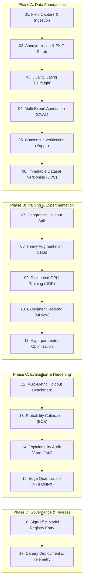
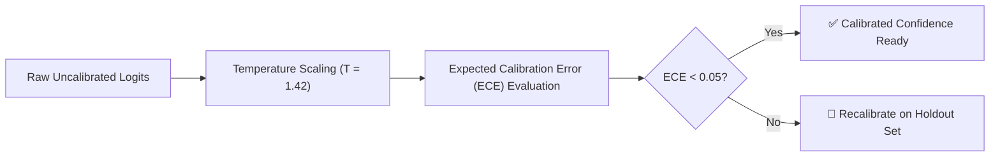
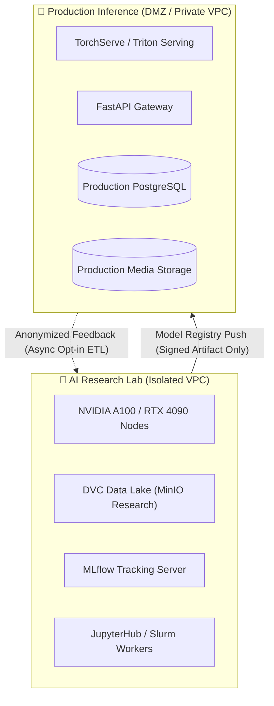

# AI Training Strategy & ML Lab Architecture / استراتيجية التدريب ومختبر الذكاء الاصطناعي

> **Document Version:** 1.0  
> **Status:** Approved / معتمد  
> **Reference:** [Foundation Document](../architecture/foundation-document.md) · [AI Engines](./ai-engines.md) · [Data Strategy](../data/data-strategy.md)

---

## 1. Executive Overview / نظرة عامة

The AgriVision AI Training Lab is an isolated research and machine learning environment dedicated to repeatable experimentation, continuous model evaluation, and systematic artifact certification. It enforces strict decoupling between active production inference clusters and experimental GPU compute nodes.

---

## 2. AI Lab Structure: Directory & Module Layout

The ML research ecosystem is organized within the monorepo under `ai/lab/`:

```
ai/lab/
├── configs/                       # Hydra / YAML experiment configurations
│   ├── model/                     # resnet50.yaml, efficientnet_b4.yaml, yolov8.yaml
│   ├── dataset/                   # tomato_v1.yaml, grape_v1.yaml, pests_yemen.yaml
│   └── training/                  # baseline_adamw.yaml, focal_loss.yaml
├── data/                          # Local scratch / symlinks to NFS data lake
│   ├── raw/                       # Unprocessed ingests
│   ├── interim/                   # Filtered & resized interim arrays
│   └── gold/                      # Immutable versioned datasets (DVC-tracked)
├── notebooks/                     # Exploratory Data Analysis & Prototyping
│   ├── 01_data_exploration.ipynb  # Class balance, aspect ratio, metadata distributions
│   ├── 02_augmentation_tests.ipynb# Albumentations visual verification
│   ├── 03_baseline_training.ipynb # Initial single-GPU sanity runs
│   ├── 04_error_analysis.ipynb    # Grad-CAM overlays & misclassification mining
│   └── 05_onnx_quantization.ipynb # INT8 calibration & parity validation
├── src/                           # Reusable production-grade ML library
│   ├── __init__.py
│   ├── datasets/                  # PyTorch Dataset & DataLoader implementations
│   ├── augmentations/             # Customized agricultural transform pipelines
│   ├── models/                    # Architecture wrappers & classification heads
│   ├── losses/                    # FocalLoss, AsymmetricLoss, LabelSmoothing
│   ├── metrics/                   # mAP, ConfusionMatrix, ECE calibration evaluators
│   ├── pipelines/                 # Training, validation, and inference loops
│   └── utils/                     # S3 clients, MLflow loggers, seed managers
├── scripts/                       # CLI automation entrypoints
│   ├── train.py                   # Distributed Data Parallel (DDP) training runner
│   ├── evaluate.py                # Comprehensive holdout evaluation suite
│   ├── export_onnx.py             # PyTorch -> ONNX FP16/INT8 compiler
│   └── generate_model_card.py     # Automated markdown card compiler
├── outputs/                       # Local run artifacts & tensorboard logs
└── requirements-lab.txt           # Dedicated ML dependency pinlist
```

---

## 3. The 17-Step Model Lifecycle / دورة حياة النموذج الهندسية (17 مرحلة)

Every model in AgriVision AI traverses an uncompromised 17-step lifecycle before serving real-world field requests:



### Phase A: Data Foundations (المراحل 1-6)
1. **Field Capture & Ingestion:** Ingest raw images/video from agricultural drives and verified submissions.
2. **Anonymization & EXIF Scrub:** Strip GPS, sensor serial numbers, and blur accidental human faces.
3. **Quality Gating:** Reject images below Laplacian blur variance thresholds ($\text{Var} < 100$) or inadequate lighting.
4. **Multi-Expert Annotation:** Dual-annotator labeling in CVAT (tagging, bounding boxes, segmentation masks).
5. **Consensus Verification:** Compute Cohen's Kappa score ($\kappa \ge 0.85$ required); discordant samples routed to chief agronomist.
6. **Immutable Dataset Versioning:** Snapshot final training corpora with DVC (Data Version Control) backed by MinIO/S3.

### Phase B: Training & Experimentation (المراحل 7-11)
7. **Geographic Holdout Partitioning:** Strict separation of test farms/regions to evaluate true spatial generalization.
8. **Heavy Augmentation Setup:** Apply domain-specific augmentations via Albumentations (solar flare, lens blur, dust simulation, leaf rotation).
9. **Distributed GPU Training:** Multi-GPU training utilizing PyTorch Distributed Data Parallel (DDP).
10. **Experiment Tracking:** Continuous logging of loss curves, learning rates, and gradient norms into MLflow.
11. **Hyperparameter Optimization:** Automated sweeps (Ray Tune / Optuna) for optimal weight decay, cosine annealing schedules, and focal gamma.

### Phase C: Evaluation & Hardening (المراحل 12-15)
12. **Multi-Metric Holdout Benchmark:** Rigorous evaluation across Precision, Recall, Macro-F1, and mAP@0.5.
13. **Probability Calibration:** Apply Temperature Scaling to ensure output probabilities represent true empirical risk.
14. **Explainability Audit:** Automated Grad-CAM batch run to guarantee neural attention focuses on pathology lesions rather than soil, weeds, or fingers.
15. **Edge Quantization:** Convert PyTorch model to ONNX format with Post-Training Quantization (PTQ) to INT8, verifying output delta $< 0.5\%$.

### Phase D: Governance & Release (المراحل 16-17)
16. **Sign-off & Model Registry Entry:** Mandatory dual cryptographic approval from ML Engineer and Chief Agronomist; automated compilation of Model Card.
17. **Canary Deployment & Telemetry:** Deploy to 5% of production traffic with real-time drift monitoring and one-click rollback triggers.

---

## 4. Evaluation Metrics & Standards Matrix

| Metric | Target (Cloud Server) | Target (Edge Mobile) | Operational Significance |
|---|:---:|:---:|---|
| **Macro F1-Score** | $\ge 0.94$ | $\ge 0.90$ | Balances accuracy across rare and common diseases equally. |
| **Recall (Critical Pathogens)**| $\ge 0.98$ | $\ge 0.95$ | Minimizes false negatives on catastrophic blights (Late Blight). |
| **mAP@0.5 (Pest Detection)** | $\ge 0.88$ | N/A (Server Only) | Accurate identification of insect pest bounding boxes. |
| **mAP@0.5:0.95 (Pests)** | $\ge 0.65$ | N/A (Server Only) | Stringent spatial tightness on small insect boundaries. |
| **Intersection over Union (IoU)**| $\ge 0.80$ | N/A | Semantic segmentation accuracy for lesion area calculation. |
| **Dice Coefficient** | $\ge 0.85$ | N/A | Overlap quality on delicate leaf necrosis patches. |
| **Inference Latency** | $\le 120\text{ ms}$ (GPU) | $\le 200\text{ ms}$ (ARM) | Guarantees fluid user experience without app lag. |
| **RAM Footprint** | $< 2.0\text{ GB}$ (VRAM) | $< 65\text{ MB}$ (DRAM) | Allows background execution on low-cost Android phones. |

---

## 5. Confidence Calibration Requirements / معايرة الثقة

Modern deep neural networks suffer from severe overconfidence; a model might output 99% Softmax probability on an out-of-distribution weed.

AgriVision AI enforces **Temperature Scaling Calibration**:
$$p_i = \frac{\exp(z_i / T)}{\sum_j \exp(z_j / T)}$$
Where $z$ are the unnormalized logits and $T > 0$ is the learned temperature parameter optimized on the validation set.



- **Target:** Expected Calibration Error (ECE) must be $< 0.05$ across all operational diagnosis classes.
- **Out-of-Distribution (OOD) Gating:** If the maximum calibrated probability is $< 0.70$, the prediction is flagged as "غير مؤكد - يتطلب مراجعة مهندس زراعي" (Uncertain - requires agronomist review).

---

## 6. Production vs. Training Environment Separation

To guarantee data integrity, reproducibility, and system uptime:



### Strict Architectural Boundaries:
1. **No Live DB Access from Notebooks:** Researchers never connect Jupyter notebooks to production PostgreSQL. Training runs consume read-only immutable DVC dataset exports.
2. **No Online Learning:** Production models are entirely static weights. No gradient updates occur on production servers.
3. **Artifact Promotion Gate:** The only pipeline bridging the Lab to Production is the signed Model Registry promoting compiled `.onnx` or `.pt` packages.

---

## 7. Model Card Standard Specification / مواصفة بطاقة النموذج

Every certified model must include an automatically compiled JSON/Markdown Model Card containing:
1. **Model Details:** Architecture, parameter count, input shape, quantization format, checksum (SHA-256).
2. **Intended Use:** Specific crops, supported geographic zones, and target growth stages.
3. **Out-of-Scope Use Cases:** Explicit statement of conditions where the model is invalid (e.g., hydroponic greenhouse seedlings, post-harvest fruit decay).
4. **Training Data Lineage:** DVC dataset commit hash, sample counts per class, geographic provenance distribution.
5. **Evaluation Metrics:** Disaggregated performance tables showing Precision, Recall, and F1 across each individual pathogen class.
6. **Ethical & Safety Disclaimers:** Guidance on false-positive impacts and pesticide application disclaimers.
