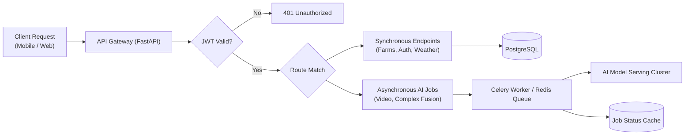
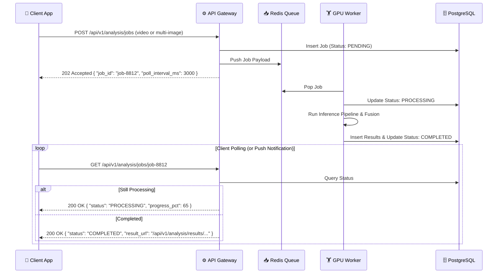

# REST API Architecture & Interface Specification / معمارية وتصميم واجهات البرمجة

> **Document Version:** 1.0  
> **Status:** Approved / معتمد  
> **Reference:** [Foundation Document](../architecture/foundation-document.md) · [System Overview](../architecture/system-overview.md) · [Data Architecture](../architecture/data-architecture.md)

---

## 1. Architectural Principles / المبادئ الهندسية لتصميم الواجهات

The AgriVision AI API layer is built with FastAPI (Python 3.11+), conforming strictly to RESTful conventions, JSON payloads, OpenAPI 3.1 specifications, and asynchronous non-blocking I/O.

### Core Standards:
- **Base URL:** `https://api.agrivision.ai/api/v1`
- **Authentication:** Bearer JWT in the `Authorization` header (`Authorization: Bearer <access_token>`).
- **Response Format:** Standardized envelope returning unified status, payload, and localized error messages.
- **Asynchronous Processing:** Long-running machine learning workloads (YOLO pest counts, video analyses) follow the **Asynchronous Job Pattern** (202 Accepted with polling and webhooks).



---

## 2. Standard API Response Envelopes / مغلفات الاستجابة الموحدة

### Success Response Envelope:
```json
{
  "success": true,
  "status_code": 200,
  "data": { ... },
  "message_ar": "تمت العملية بنجاح",
  "message_en": "Operation completed successfully",
  "timestamp": "2024-06-15T09:30:00Z"
}
```

### Error Response Envelope:
```json
{
  "success": false,
  "status_code": 400,
  "error": {
    "code": "INVALID_IMAGE_QUALITY",
    "details": "Image Laplacian variance is 42 (minimum threshold is 100)",
    "message_ar": "الصورة ضبابية وغير واضحة، يُرجى إعادة التصوير مع تثبيت الكاميرا",
    "message_en": "Image is blurry; please retake with a steady camera"
  },
  "timestamp": "2024-06-15T09:30:00Z"
}
```

---

## 3. AgriVision Farmer App API Endpoints / واجهات تطبيق المزارع

### 3.1 Authentication & Profile (`/api/v1/auth`)

| Method | Endpoint | Description | Auth Required |
|---|---|---|:---:|
| `POST` | `/auth/request-otp` | Request SMS verification code for mobile number | ❌ |
| `POST` | `/auth/verify-otp` | Submit OTP and receive JWT access + refresh tokens | ❌ |
| `POST` | `/auth/refresh-token` | Exchange valid refresh token for fresh access token | ❌ |
| `GET` | `/auth/me` | Fetch active user profile, assigned roles, and stats | ✅ |
| `PATCH`| `/auth/me` | Update language, name, preferred units, or avatar | ✅ |

### 3.2 Farms & Plots (`/api/v1/farms`)

| Method | Endpoint | Description |
|---|---|---|
| `GET` | `/farms` | List all farms owned by the authenticated farmer |
| `POST` | `/farms` | Register a new farm (name, governorate, district, area) |
| `GET` | `/farms/{farm_id}` | Fetch detailed farm profile, plots, and active crops |
| `PATCH`| `/farms/{farm_id}` | Update farm details or boundary polygons |
| `DELETE`| `/farms/{farm_id}` | Soft-delete a farm record |
| `POST` | `/farms/{farm_id}/plots` | Add an individual agricultural plot to a farm |

### 3.3 Crop Plantings (`/api/v1/plantings`)

| Method | Endpoint | Description |
|---|---|---|
| `GET` | `/farms/{farm_id}/plantings` | List active crop plantings for a specific farm |
| `POST` | `/plantings` | Register new crop planting (crop type, variety, date) |
| `GET` | `/plantings/{planting_id}` | Retrieve crop timeline, health score, and diagnostic history |
| `PATCH`| `/plantings/{planting_id}/stage`| Update phenological growth stage (e.g., Flowering → Fruiting) |

### 3.4 Media Ingestion & Upload (`/api/v1/media`)

| Method | Endpoint | Description |
|---|---|---|
| `POST` | `/media/presigned-upload-url` | Generate presigned S3 PUT URL for direct client upload |
| `POST` | `/media/confirm-upload` | Confirm upload completion and trigger metadata extraction |
| `GET` | `/media/{media_id}` | Retrieve media access URL and image quality scores |

### 3.5 AI Diagnostic & Analysis (`/api/v1/analysis`)

| Method | Endpoint | Description | Pattern |
|---|---|---|:---:|
| `POST` | `/analysis/diagnose-image` | Submit image for immediate disease & pest analysis | Sync ($\le 3\text{s}$) |
| `POST` | `/analysis/jobs` | Submit batch analysis or video walkthrough | Async (202 Accepted) |
| `GET` | `/analysis/jobs/{job_id}` | Poll execution status and progress of an async job | Polling / Status |
| `GET` | `/analysis/results/{request_id}`| Fetch full unified report and decision recommendations | Read |
| `POST` | `/analysis/{request_id}/feedback` | Submit farmer feedback (Confirm / Reject / Correction) | Write |

### 3.6 Weather & Frost Alerts (`/api/v1/weather`)

| Method | Endpoint | Description |
|---|---|---|
| `GET` | `/weather/forecast` | Fetch 7-day hourly forecast for farm coordinates |
| `GET` | `/weather/frost-risk` | Real-time frost risk score and 12-hr advance alert |
| `GET` | `/weather/spray-window` | Optimal chemical spraying windows for the upcoming 48 hours |

### 3.7 Smart Pesticide Knowledge (`/api/v1/pesticides`)

| Method | Endpoint | Description |
|---|---|---|
| `POST` | `/pesticides/scan-label` | Submit label photo for OCR and chemical extraction |
| `GET` | `/pesticides/search` | Search registered pesticides by trade name or active ingredient |
| `POST` | `/pesticides/calculate-dosage` | Calculate tank volume dosage and mandatory PHI dates |

---

## 4. AgriVision AI Studio API Endpoints / واجهات مختبر الذكاء الاصطناعي

AI Studio endpoints require elevated privileges (`researcher` or `admin` roles).

### 4.1 Dataset Curation & Management (`/api/v1/studio/datasets`)

| Method | Endpoint | Description |
|---|---|---|
| `GET` | `/studio/datasets` | List all curated datasets, versions, and sample stats |
| `POST` | `/studio/datasets` | Create a new dataset container (task type, crop scope) |
| `POST` | `/studio/datasets/{id}/import` | Ingest bulk archives from S3, PlantDoc, or field drives |
| `GET` | `/studio/datasets/{id}/samples` | Filterable query of individual samples and annotations |
| `POST` | `/studio/datasets/{id}/export` | Generate immutable snapshot with DVC manifest |

### 4.2 Training Runs & Experimentation (`/api/v1/studio/training-runs`)

| Method | Endpoint | Description |
|---|---|---|
| `POST` | `/studio/training-runs` | Queue a distributed PyTorch training run with configs |
| `GET` | `/studio/training-runs` | List ongoing and completed training experiments |
| `GET` | `/studio/training-runs/{id}`| Real-time loss curves, tensorboard link, and MLflow ID |
| `POST` | `/studio/training-runs/{id}/abort` | Terminate an active GPU training job |

### 4.3 Evaluation & Model Registry (`/api/v1/studio/models`)

| Method | Endpoint | Description |
|---|---|---|
| `GET` | `/studio/models` | List all registered model architectures and versions |
| `POST` | `/studio/models/register` | Register new model artifact with evaluation card |
| `POST` | `/studio/models/{id}/quantize` | Trigger edge quantization (INT8 ONNX conversion) |
| `POST` | `/studio/models/{id}/promote` | Promote model stage (`draft` → `staging` → `production`) |
| `POST` | `/studio/models/{id}/rollback`| Revert production traffic to previous model version |

---

## 5. Asynchronous Job Flow Pattern / نمط إدارة المهام غير المتزامنة



---

## 6. API Versioning & Evolution Strategy / استراتيجية إدارة الإصدارات

1. **URI Path Versioning:** All endpoints include major version prefixes in their URI path (`/api/v1/`, `/api/v2/`).
2. **Backward-Compatibility Guarantee:** Minor additions (new response fields, optional query parameters) are released without changing the major URI version.
3. **Deprecation Lifecycle:**
   - Deprecated endpoints return a standard HTTP header: `Deprecation: @<timestamp>` and `Sunset: @<timestamp>`.
   - Minimum 6 months deprecation window before decommissioning legacy endpoints, ensuring rural farmers on older mobile app releases are not abruptly broken.
