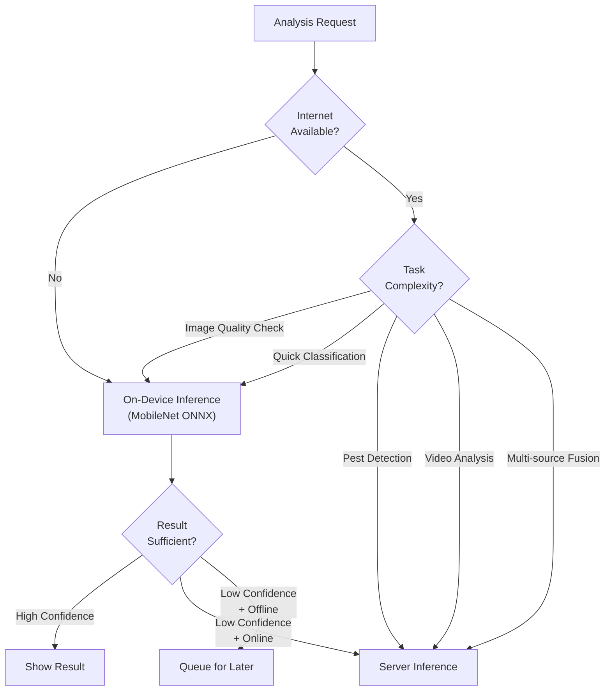

# Architecture Decision Records / سجلات القرارات المعمارية

> **Document Version:** 1.0  
> **Status:** Approved / معتمد  
> **Reference:** [Foundation Document](./foundation-document.md)

---

## Overview / نظرة عامة

This document records the key architectural decisions made for the AgriVision AI platform, following the Architecture Decision Record (ADR) format. Each decision includes context, the decision itself, consequences, and status.

---

## ADR-001: Monorepo Structure / هيكل المستودع الموحد

| Field | Value |
|-------|-------|
| **Status** | ✅ Accepted |
| **Date** | 2024-01-15 |
| **Deciders** | Architecture Team |

### Context / السياق

The AgriVision AI platform consists of multiple components: a Flutter mobile app, a FastAPI backend, AI training notebooks, a React dashboard, shared data schemas, and documentation. We need to decide whether to use a monorepo (single repository) or polyrepo (multiple repositories) structure.

النظام يتكون من عدة مكونات: تطبيق Flutter للموبايل، خادم FastAPI، دفاتر تدريب AI، لوحة React، مخططات بيانات مشتركة، والتوثيق.

### Decision / القرار

**Use a monorepo structure** with the following layout:

```
agrivision-ai/
├── apps/
│   ├── farmer-app/          # Flutter mobile app
│   ├── api-server/          # FastAPI backend
│   └── web-dashboard/       # React AI Studio + Admin
├── ai/
│   ├── lab/                 # Training notebooks and experiments
│   └── models/              # Production model definitions
├── packages/
│   └── shared/              # Shared schemas, types, constants
├── data/
│   └── schemas/             # Database migrations, seed data
├── docs/                    # All documentation
├── deploy/                  # Docker, CI/CD configs
└── tests/
    ├── integration/         # Cross-component tests
    └── e2e/                 # End-to-end tests
```

### Rationale / المبررات

1. **Unified contracts** — Shared data schemas and API contracts are versioned together, preventing integration drift
2. **Atomic changes** — A single PR can update the API, the mobile app, and the AI model interface simultaneously
3. **Simplified CI/CD** — One pipeline with selective builds based on changed paths
4. **Cross-component testing** — Integration tests run against consistent component versions
5. **Team coordination** — Easier onboarding and knowledge sharing across the small team
6. **Early stage** — The team is small enough that monorepo overhead is minimal

### Consequences / العواقب

| Positive | Negative |
|----------|----------|
| Consistent versioning across components | Repository size grows over time |
| Easy cross-component refactoring | Need path-based CI triggers |
| Single source of truth for contracts | Clone time increases with AI datasets |
| Simplified dependency management | Requires careful `.gitignore` for large files |

### Alternatives Considered / البدائل

- **Polyrepo:** Each component in its own repository. Rejected due to integration overhead for a small team.
- **Hybrid:** Core in monorepo, AI datasets in separate repo. May adopt later as dataset size grows.

---

## ADR-002: Flutter for Mobile / Flutter للتطبيق المحمول

| Field | Value |
|-------|-------|
| **Status** | ✅ Accepted |
| **Date** | 2024-01-15 |
| **Deciders** | Architecture Team |

### Context / السياق

The farmer application must run on Android devices (primary target for Yemeni market), support Arabic RTL layouts, integrate with on-device AI models (ONNX Runtime), access camera and GPS, and work offline.

تطبيق المزارع يجب أن يعمل على أجهزة أندرويد (السوق المستهدف في اليمن)، يدعم العربية RTL، يتكامل مع نماذج AI محلية، يستخدم الكاميرا وGPS، ويعمل بدون إنترنت.

### Decision / القرار

**Use Flutter (Dart)** as the mobile development framework.

### Rationale / المبررات

1. **Cross-platform potential** — Write once, deploy to Android (primary) and iOS (future)
2. **Arabic RTL support** — Built-in excellent RTL and internationalization support
3. **ONNX Runtime integration** — Available Flutter plugins for on-device ML inference
4. **Performance** — Compiled to native ARM code, suitable for image processing
5. **Camera integration** — Rich camera plugin ecosystem for image and video capture
6. **Offline-first** — SQLite support via `sqflite`, Hive for local storage
7. **UI richness** — Material Design widgets for data visualization and agricultural dashboards

### Consequences / العواقب

| Positive | Negative |
|----------|----------|
| Single codebase for Android (+ future iOS) | Dart ecosystem smaller than Kotlin/Swift |
| Excellent RTL/Arabic support | Platform-specific features need plugins |
| Strong offline data capabilities | ML integration requires native bridges |
| Active community and Google backing | Larger APK size than native |

### Alternatives Considered / البدائل

- **Kotlin (Native Android):** Better platform integration but no cross-platform path. Rejected for future flexibility.
- **React Native:** Larger ecosystem but weaker RTL support and performance concerns for image processing.
- **KMP (Kotlin Multiplatform):** Immature UI layer at time of decision.

---

## ADR-003: FastAPI for Backend / FastAPI للخادم

| Field | Value |
|-------|-------|
| **Status** | ✅ Accepted |
| **Date** | 2024-01-15 |
| **Deciders** | Architecture Team |

### Context / السياق

The backend must serve REST APIs for the farmer app, orchestrate AI inference jobs, integrate with weather services, manage file uploads to object storage, and interact with the PostgreSQL database. The AI components are written in Python (PyTorch, OpenCV).

الخادم يجب أن يقدم واجهات REST لتطبيق المزارع، ينسق مهام الاستدلال، يتكامل مع خدمات الطقس، يدير رفع الملفات، ويتفاعل مع قاعدة البيانات. مكونات AI مكتوبة بـ Python.

### Decision / القرار

**Use FastAPI (Python)** as the backend framework.

### Rationale / المبررات

1. **Python ecosystem alignment** — Same language as AI/ML stack (PyTorch, OpenCV, scikit-learn)
2. **Async support** — Native async/await for I/O-bound operations (file uploads, external APIs)
3. **Auto-documentation** — OpenAPI/Swagger docs generated from type annotations
4. **Type safety** — Pydantic models for request/response validation
5. **Performance** — Among the fastest Python frameworks (ASGI-based)
6. **Background tasks** — Built-in support + Celery integration for long-running AI jobs
7. **Community** — Active ecosystem with well-maintained plugins

### Consequences / العواقب

| Positive | Negative |
|----------|----------|
| Shared language with AI team | Python GIL limits CPU-bound parallelism |
| Excellent API documentation | Need Celery/workers for heavy computation |
| Strong type validation | Deployment requires ASGI server (Uvicorn) |
| Easy to prototype and iterate | Less performant than Go/Rust for pure API serving |

### Alternatives Considered / البدائل

- **Django REST Framework:** More batteries-included but heavier, less async-friendly.
- **Go (Gin/Echo):** Excellent performance but language mismatch with AI stack.
- **Node.js (Express/Fastify):** Good async but language mismatch with AI stack.

---

## ADR-004: PostgreSQL + Object Storage / PostgreSQL + تخزين الكائنات

| Field | Value |
|-------|-------|
| **Status** | ✅ Accepted |
| **Date** | 2024-01-15 |
| **Deciders** | Architecture Team |

### Context / السياق

The platform needs to store: structured data (users, farms, crops, analysis results), geographic data (farm locations, regional boundaries), binary assets (images, videos, model files), and metadata linking structured records to binary assets.

المنصة تحتاج تخزين: بيانات منظمة (مستخدمين، مزارع، محاصيل)، بيانات جغرافية (مواقع المزارع)، ملفات (صور، فيديو، نماذج)، وبيانات وصفية تربط السجلات بالملفات.

### Decision / القرار

**Use PostgreSQL with PostGIS** for structured + geographic data, and **S3-compatible object storage (MinIO)** for binary assets.

### Rationale / المبررات

#### PostgreSQL + PostGIS
1. **Relational integrity** — ACID transactions for user data, farm records, analysis results
2. **PostGIS** — Native geographic queries (farm proximity, regional analysis, weather station mapping)
3. **JSON support** — JSONB columns for flexible metadata and AI model outputs
4. **Full-text search** — Arabic text search for crop names, disease descriptions
5. **Maturity** — Battle-tested, excellent tooling, wide hosting options

#### Object Storage (MinIO / S3)
1. **Scalable binary storage** — Purpose-built for large binary files (images, videos, models)
2. **Signed URLs** — Direct upload/download without proxying through the API server
3. **Cost-effective** — Tiered storage for infrequently accessed historical data
4. **S3 compatibility** — Easy migration to AWS S3 or other cloud providers

### Consequences / العواقب

| Positive | Negative |
|----------|----------|
| Strong data integrity | Two storage systems to manage |
| Geographic queries out-of-the-box | Object storage adds infrastructure complexity |
| Flexible metadata with JSONB | Need to keep references in sync |
| Scalable media storage | Self-hosted MinIO requires operational expertise |

### Data Separation Strategy / استراتيجية فصل البيانات

```
PostgreSQL:
  ├── User accounts, authentication
  ├── Farm & crop records
  ├── Analysis requests & results
  ├── Weather data & alerts
  ├── Knowledge base (pesticides, diseases)
  └── AI Studio metadata (datasets, experiments, model registry)

Object Storage:
  ├── /uploads/         → User-uploaded images & videos
  ├── /processed/       → Preprocessed and augmented images
  ├── /models/          → Trained model artifacts (.pt, .onnx)
  ├── /exports/         → Dataset exports, reports
  └── /annotations/     → CVAT annotation exports
```

---

## ADR-005: Hybrid AI (Phone + Server) / الذكاء الاصطناعي الهجين

| Field | Value |
|-------|-------|
| **Status** | ✅ Accepted |
| **Date** | 2024-01-15 |
| **Deciders** | Architecture Team |

### Context / السياق

Yemen has significant connectivity challenges: intermittent internet, limited bandwidth in rural areas, and farmers who need results quickly in the field. At the same time, some AI tasks require large models and fusion of multiple data sources that cannot run on a phone.

اليمن تواجه تحديات في الاتصال: إنترنت متقطع، عرض نطاق محدود في المناطق الريفية، ومزارعون يحتاجون نتائج سريعة في الحقل. لكن بعض مهام AI تتطلب نماذج كبيرة لا يمكن تشغيلها على الهاتف.

### Decision / القرار

**Implement a hybrid inference architecture** where lightweight tasks run on the phone and complex tasks run on the server, with intelligent routing and an offline queue.

### Routing Logic / منطق التوجيه



### Consequences / العواقب

| Positive | Negative |
|----------|----------|
| Works in low-connectivity areas | Two model deployment targets to maintain |
| Instant feedback for simple tasks | Model version sync challenges |
| Reduced server costs | On-device models have lower accuracy |
| Graceful degradation | More complex testing matrix |

> [!IMPORTANT]
> See [Hybrid Inference Strategy](./hybrid-inference.md) for the full specification.

---

## ADR-006: Separate Training from Production / فصل التدريب عن الإنتاج

| Field | Value |
|-------|-------|
| **Status** | ✅ Accepted |
| **Date** | 2024-01-15 |
| **Deciders** | Architecture Team |

### Context / السياق

Many AI systems allow production data to directly influence model behavior (online learning). This creates risks: noisy labels, adversarial inputs, and uncontrolled model drift.

كثير من أنظمة AI تسمح لبيانات الإنتاج بالتأثير المباشر على سلوك النموذج. هذا يخلق مخاطر: تسميات مشوشة، مدخلات خبيثة، وانحراف غير متحكم فيه.

### Decision / القرار

**Strictly separate the training pipeline from the production inference pipeline.** No production model learns directly from user-uploaded data. All data flows through a curated pipeline:

```
User Upload → Review → Annotation → Validation → Training → Evaluation → Approval → Deployment
```

### Rules / القواعد

1. **No automatic learning:** Production models do not update from user data
2. **Curated pipeline:** All training data goes through expert review and annotation
3. **Gated deployment:** No model reaches production without passing evaluation criteria
4. **Version control:** Every production model has a registered version with a model card
5. **Rollback capability:** Previous model versions are always available for rollback
6. **A/B testing:** New models can be deployed to a subset of users before full rollout

### Consequences / العواقب

| Positive | Negative |
|----------|----------|
| Controlled model quality | Slower model improvement cycle |
| No adversarial data poisoning | Requires human annotators |
| Auditable model lineage | Training data may lag behind field reality |
| Reproducible experiments | Higher operational overhead |

---

## ADR-007: Multi-Crop from Day One / تعدد المحاصيل منذ اليوم الأول

| Field | Value |
|-------|-------|
| **Status** | ✅ Accepted |
| **Date** | 2024-01-15 |
| **Deciders** | Architecture Team |

### Context / السياق

Yemen has diverse agriculture: qat, coffee, grapes, mangoes, dates, cereals, and vegetables. Starting with a single crop would be simpler but would require significant refactoring to support multiple crops later.

اليمن لديها زراعة متنوعة: القات، البن، العنب، المانجو، التمور، الحبوب، والخضروات. البدء بمحصول واحد أبسط لكن سيتطلب إعادة هيكلة كبيرة لاحقاً.

### Decision / القرار

**Design all data schemas, APIs, models, and UI components to support multiple crops from the beginning**, but launch AI diagnosis incrementally per crop as data and validation allow.

### Implementation / التطبيق

- **Database:** `crop_types` table with all crops; every analysis linked to a `crop_id`
- **AI Models:** Crop-aware classification (crop as input context or separate model per crop group)
- **UI:** Dynamic crop selector; features enabled/disabled per crop based on model readiness
- **Knowledge Base:** Crop-specific disease catalogs, pest profiles, pesticide recommendations

> [!IMPORTANT]
> لا يجوز عرض تشخيص لفئة لم يتم تدريب النموذج عليها والتحقق منها.
>
> No diagnosis may be displayed for a category the model has not been trained and validated on.

---

## ADR-008: Yemen-First Geographic Focus / اليمن أولاً كنطاق جغرافي

| Field | Value |
|-------|-------|
| **Status** | ✅ Accepted |
| **Date** | 2024-01-15 |
| **Deciders** | Architecture Team |

### Context / السياق

Generic agricultural AI platforms trained on international datasets may not accurately reflect Yemeni conditions: local crop varieties, regional pest populations, unique climate zones, traditional farming practices, and Arabic agricultural terminology.

منصات AI الزراعية العامة المدربة على بيانات دولية قد لا تعكس بدقة الظروف اليمنية: أصناف محلية، آفات إقليمية، مناطق مناخية فريدة، ممارسات زراعية تقليدية، ومصطلحات زراعية عربية.

### Decision / القرار

**Focus the platform exclusively on Yemen** as the geographic scope, with architecture that supports regional variation within the country.

### Regional Architecture / المعمارية الإقليمية

```
Yemen
├── Governorate (محافظة)
│   ├── District (مديرية)
│   │   └── Agricultural Zone (منطقة زراعية)
│   │       ├── Climate profile
│   │       ├── Common crops
│   │       ├── Known pests/diseases
│   │       └── Weather station links
```

### Key Implications / التبعات الرئيسية

1. **Local data collection** — Priority investment in Yemeni field data
2. **Geographic holdout testing** — Models tested across regions, not just random splits
3. **Weather integration** — Yemen-specific weather stations and data sources
4. **Language** — Arabic-first UI and agricultural terminology
5. **Crop varieties** — Yemeni cultivars, not generic species
6. **Regulatory** — Yemeni pesticide regulations and approved products
7. **Connectivity** — Designed for Yemen's internet infrastructure realities

### Consequences / العواقب

| Positive | Negative |
|----------|----------|
| Deep local relevance | Limited to one country initially |
| Better accuracy for Yemeni conditions | Less international training data applicable |
| Trust from local farmers | Smaller initial market |
| Regional agricultural intelligence | Need local data collection infrastructure |

---

## Decision Summary / ملخص القرارات

| ADR | Decision | Status |
|-----|----------|--------|
| ADR-001 | Monorepo structure | ✅ Accepted |
| ADR-002 | Flutter for mobile | ✅ Accepted |
| ADR-003 | FastAPI for backend | ✅ Accepted |
| ADR-004 | PostgreSQL + Object Storage | ✅ Accepted |
| ADR-005 | Hybrid AI (phone + server) | ✅ Accepted |
| ADR-006 | Separate training from production | ✅ Accepted |
| ADR-007 | Multi-crop from day one | ✅ Accepted |
| ADR-008 | Yemen-first geographic focus | ✅ Accepted |
