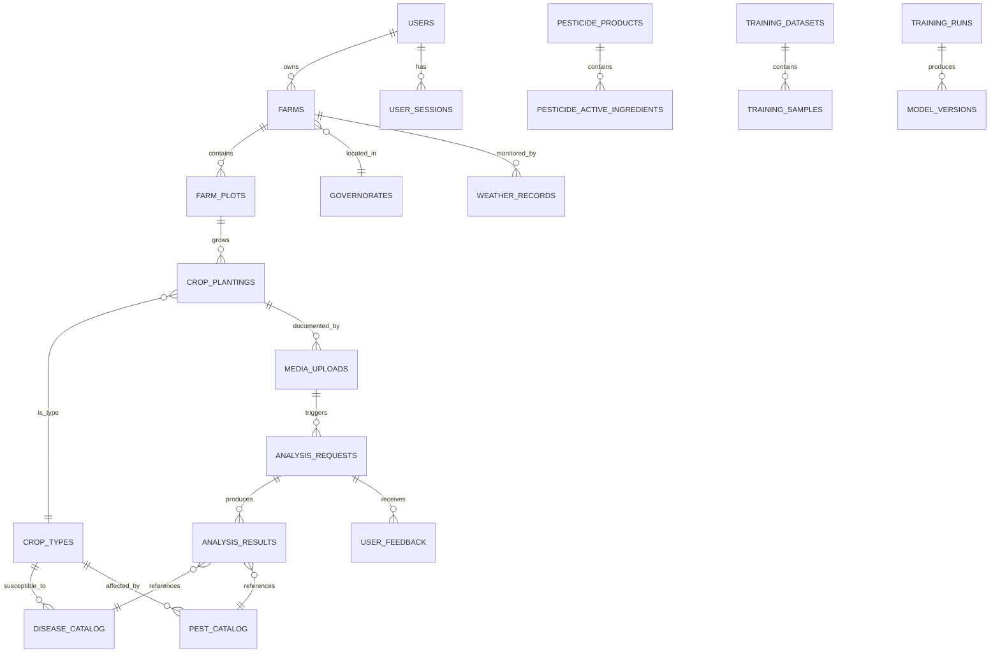
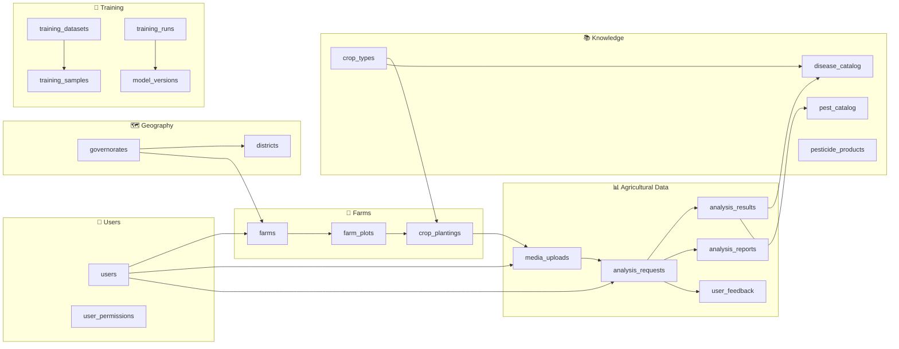
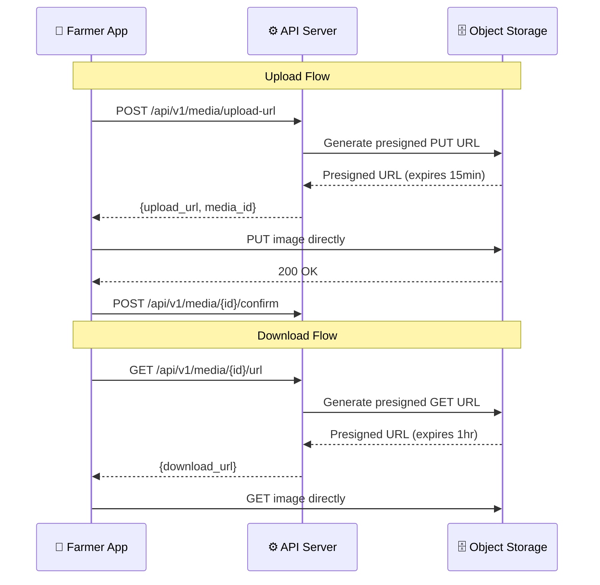

# Data Architecture / معمارية البيانات

> **Document Version:** 1.0  
> **Status:** Approved / معتمد  
> **Reference:** [Foundation Document](./foundation-document.md) · [ADR-004](./architecture-decisions.md#adr-004-postgresql--object-storage)

---

## 1. Overview / نظرة عامة

AgriVision AI uses a dual-storage architecture: **PostgreSQL with PostGIS** for structured and geographic data, and **S3-compatible Object Storage (MinIO)** for binary assets. This document details the database design, table groups, relationships, and storage strategies.

---

## 2. Database Schema Overview / نظرة عامة على مخطط قاعدة البيانات



---

## 3. Table Groups / مجموعات الجداول

### 3.1 Users & Authentication / المستخدمون والمصادقة

```sql
-- Core user account
CREATE TABLE users (
    id              UUID PRIMARY KEY DEFAULT gen_random_uuid(),
    phone_number    VARCHAR(20) UNIQUE NOT NULL,
    full_name       VARCHAR(200) NOT NULL,
    email           VARCHAR(255),
    password_hash   VARCHAR(255) NOT NULL,
    role            VARCHAR(50) NOT NULL DEFAULT 'farmer',  -- farmer, agronomist, researcher, admin
    language        VARCHAR(10) DEFAULT 'ar',
    avatar_url      TEXT,
    is_active       BOOLEAN DEFAULT true,
    is_verified     BOOLEAN DEFAULT false,
    last_login_at   TIMESTAMPTZ,
    created_at      TIMESTAMPTZ DEFAULT NOW(),
    updated_at      TIMESTAMPTZ DEFAULT NOW()
);

-- User sessions and tokens
CREATE TABLE user_sessions (
    id              UUID PRIMARY KEY DEFAULT gen_random_uuid(),
    user_id         UUID NOT NULL REFERENCES users(id) ON DELETE CASCADE,
    device_id       VARCHAR(255),
    device_info     JSONB,           -- {model, os_version, app_version, screen_size}
    refresh_token   VARCHAR(500) NOT NULL,
    ip_address      INET,
    is_active       BOOLEAN DEFAULT true,
    expires_at      TIMESTAMPTZ NOT NULL,
    created_at      TIMESTAMPTZ DEFAULT NOW()
);

-- User roles and permissions
CREATE TABLE user_permissions (
    id              UUID PRIMARY KEY DEFAULT gen_random_uuid(),
    user_id         UUID NOT NULL REFERENCES users(id) ON DELETE CASCADE,
    permission      VARCHAR(100) NOT NULL,  -- e.g., 'studio:datasets:write', 'admin:users:read'
    granted_by      UUID REFERENCES users(id),
    granted_at      TIMESTAMPTZ DEFAULT NOW(),
    UNIQUE(user_id, permission)
);
```

### 3.2 Farms & Geography / المزارع والجغرافيا

```sql
-- Geographic hierarchy
CREATE TABLE governorates (
    id              SERIAL PRIMARY KEY,
    name_ar         VARCHAR(200) NOT NULL,   -- اسم المحافظة
    name_en         VARCHAR(200),
    boundary        GEOMETRY(MultiPolygon, 4326),  -- PostGIS boundary
    climate_zone    VARCHAR(50)
);

CREATE TABLE districts (
    id              SERIAL PRIMARY KEY,
    governorate_id  INTEGER NOT NULL REFERENCES governorates(id),
    name_ar         VARCHAR(200) NOT NULL,   -- اسم المديرية
    name_en         VARCHAR(200),
    boundary        GEOMETRY(MultiPolygon, 4326)
);

-- Farm records
CREATE TABLE farms (
    id              UUID PRIMARY KEY DEFAULT gen_random_uuid(),
    owner_id        UUID NOT NULL REFERENCES users(id),
    name            VARCHAR(200) NOT NULL,
    governorate_id  INTEGER REFERENCES governorates(id),
    district_id     INTEGER REFERENCES districts(id),
    location        GEOMETRY(Point, 4326),     -- PostGIS point (obfuscated for privacy)
    area_hectares   DECIMAL(10,2),
    altitude_m      INTEGER,
    irrigation_type VARCHAR(50),               -- rain-fed, well, canal, drip
    soil_type       VARCHAR(100),
    notes           TEXT,
    created_at      TIMESTAMPTZ DEFAULT NOW(),
    updated_at      TIMESTAMPTZ DEFAULT NOW()
);

-- Individual plots within a farm
CREATE TABLE farm_plots (
    id              UUID PRIMARY KEY DEFAULT gen_random_uuid(),
    farm_id         UUID NOT NULL REFERENCES farms(id) ON DELETE CASCADE,
    name            VARCHAR(200),
    boundary        GEOMETRY(Polygon, 4326),
    area_hectares   DECIMAL(10,2),
    soil_type       VARCHAR(100),
    created_at      TIMESTAMPTZ DEFAULT NOW()
);
```

### 3.3 Crops / المحاصيل

```sql
-- Crop type catalog
CREATE TABLE crop_types (
    id              SERIAL PRIMARY KEY,
    name_ar         VARCHAR(200) NOT NULL,    -- اسم المحصول بالعربية
    name_en         VARCHAR(200) NOT NULL,
    name_local      VARCHAR(200),             -- الاسم المحلي اليمني
    scientific_name VARCHAR(200),
    family          VARCHAR(100),
    category        VARCHAR(50),              -- fruit, vegetable, cereal, cash_crop, legume
    growth_stages   JSONB,                    -- [{name_ar, name_en, duration_days}]
    optimal_temp    JSONB,                    -- {min, max, unit: "celsius"}
    icon_url        TEXT,
    is_active       BOOLEAN DEFAULT true
);

-- Crop varieties specific to Yemen
CREATE TABLE crop_varieties (
    id              SERIAL PRIMARY KEY,
    crop_type_id    INTEGER NOT NULL REFERENCES crop_types(id),
    name_ar         VARCHAR(200) NOT NULL,
    name_en         VARCHAR(200),
    region          VARCHAR(200),             -- المنطقة المعروف بها الصنف
    characteristics JSONB,
    is_local        BOOLEAN DEFAULT true
);

-- Crop plantings (a specific crop in a specific plot at a specific time)
CREATE TABLE crop_plantings (
    id              UUID PRIMARY KEY DEFAULT gen_random_uuid(),
    farm_id         UUID NOT NULL REFERENCES farms(id),
    plot_id         UUID REFERENCES farm_plots(id),
    crop_type_id    INTEGER NOT NULL REFERENCES crop_types(id),
    variety_id      INTEGER REFERENCES crop_varieties(id),
    planting_date   DATE,
    expected_harvest DATE,
    growth_stage    VARCHAR(50),
    status          VARCHAR(50) DEFAULT 'active', -- active, harvested, abandoned
    notes           TEXT,
    created_at      TIMESTAMPTZ DEFAULT NOW(),
    updated_at      TIMESTAMPTZ DEFAULT NOW()
);
```

### 3.4 Agricultural Data (Media & Analysis) / البيانات الزراعية

```sql
-- Media uploads (images and videos)
CREATE TABLE media_uploads (
    id              UUID PRIMARY KEY DEFAULT gen_random_uuid(),
    user_id         UUID NOT NULL REFERENCES users(id),
    farm_id         UUID REFERENCES farms(id),
    planting_id     UUID REFERENCES crop_plantings(id),
    media_type      VARCHAR(20) NOT NULL,     -- image, video
    storage_path    TEXT NOT NULL,             -- Object storage path
    thumbnail_path  TEXT,
    original_filename VARCHAR(500),
    mime_type       VARCHAR(100),
    file_size_bytes BIGINT,
    width           INTEGER,
    height          INTEGER,
    duration_seconds DECIMAL(10,2),           -- For video
    capture_location GEOMETRY(Point, 4326),
    capture_device  JSONB,                    -- {model, os, camera_info}
    capture_conditions JSONB,                 -- {lighting, weather, time_of_day}
    created_at      TIMESTAMPTZ DEFAULT NOW()
);

-- Analysis requests
CREATE TABLE analysis_requests (
    id              UUID PRIMARY KEY DEFAULT gen_random_uuid(),
    user_id         UUID NOT NULL REFERENCES users(id),
    media_id        UUID NOT NULL REFERENCES media_uploads(id),
    planting_id     UUID REFERENCES crop_plantings(id),
    analysis_type   VARCHAR(50) NOT NULL,     -- disease, pest, monitoring, pesticide
    status          VARCHAR(50) DEFAULT 'pending',  -- pending, processing, completed, failed
    priority        INTEGER DEFAULT 0,
    inference_mode  VARCHAR(20),              -- on_device, server, hybrid
    on_device_result JSONB,                   -- Quick on-device result
    server_job_id   VARCHAR(200),
    requested_at    TIMESTAMPTZ DEFAULT NOW(),
    started_at      TIMESTAMPTZ,
    completed_at    TIMESTAMPTZ,
    error_message   TEXT
);

-- Analysis results
CREATE TABLE analysis_results (
    id              UUID PRIMARY KEY DEFAULT gen_random_uuid(),
    request_id      UUID NOT NULL REFERENCES analysis_requests(id),
    engine          VARCHAR(50) NOT NULL,     -- plant_vision, pest_detection, etc.
    model_version   VARCHAR(100),
    result_type     VARCHAR(50),              -- classification, detection, segmentation
    predictions     JSONB NOT NULL,           -- [{class, confidence, bbox?, mask_path?}]
    severity        VARCHAR(20),              -- none, mild, moderate, severe
    confidence      DECIMAL(5,4),             -- Overall confidence 0.0000-1.0000
    processing_time_ms INTEGER,
    metadata        JSONB,                    -- Engine-specific metadata
    created_at      TIMESTAMPTZ DEFAULT NOW()
);

-- Unified reports (decision support output)
CREATE TABLE analysis_reports (
    id              UUID PRIMARY KEY DEFAULT gen_random_uuid(),
    request_id      UUID NOT NULL REFERENCES analysis_requests(id),
    user_id         UUID NOT NULL REFERENCES users(id),
    report_type     VARCHAR(50),              -- standard, detailed, monitoring
    summary_ar      TEXT,                     -- Arabic summary
    summary_en      TEXT,                     -- English summary
    findings        JSONB NOT NULL,           -- Structured findings from all engines
    recommendations JSONB,                    -- Treatment/action recommendations
    confidence_level VARCHAR(20),             -- low, medium, high
    evidence_sources JSONB,                   -- Which engines contributed
    created_at      TIMESTAMPTZ DEFAULT NOW()
);

-- User feedback on analysis
CREATE TABLE user_feedback (
    id              UUID PRIMARY KEY DEFAULT gen_random_uuid(),
    request_id      UUID NOT NULL REFERENCES analysis_requests(id),
    user_id         UUID NOT NULL REFERENCES users(id),
    rating          INTEGER CHECK (rating BETWEEN 1 AND 5),
    is_correct      BOOLEAN,                  -- Did user confirm the diagnosis?
    correction      TEXT,                     -- User's correction if incorrect
    feedback_text   TEXT,
    created_at      TIMESTAMPTZ DEFAULT NOW()
);
```

### 3.5 AI Knowledge Base / قاعدة المعرفة

```sql
-- Disease catalog
CREATE TABLE disease_catalog (
    id              SERIAL PRIMARY KEY,
    name_ar         VARCHAR(300) NOT NULL,
    name_en         VARCHAR(300) NOT NULL,
    scientific_name VARCHAR(300),
    pathogen_type   VARCHAR(50),              -- fungal, bacterial, viral, physiological
    description_ar  TEXT,
    description_en  TEXT,
    symptoms_ar     TEXT,
    symptoms_en     TEXT,
    favorable_conditions JSONB,               -- {temperature, humidity, season}
    images          JSONB,                    -- Reference image URLs
    is_active       BOOLEAN DEFAULT true
);

-- Disease-crop association
CREATE TABLE crop_diseases (
    id              SERIAL PRIMARY KEY,
    crop_type_id    INTEGER NOT NULL REFERENCES crop_types(id),
    disease_id      INTEGER NOT NULL REFERENCES disease_catalog(id),
    prevalence      VARCHAR(20),              -- common, occasional, rare
    severity_potential VARCHAR(20),           -- low, medium, high, critical
    model_class_id  VARCHAR(100),             -- Class label in the AI model
    is_validated    BOOLEAN DEFAULT false,    -- Has model been validated for this?
    UNIQUE(crop_type_id, disease_id)
);

-- Pest catalog
CREATE TABLE pest_catalog (
    id              SERIAL PRIMARY KEY,
    name_ar         VARCHAR(300) NOT NULL,
    name_en         VARCHAR(300) NOT NULL,
    scientific_name VARCHAR(300),
    order_family    VARCHAR(200),
    description_ar  TEXT,
    description_en  TEXT,
    damage_type     VARCHAR(100),             -- chewing, sucking, boring, etc.
    lifecycle       JSONB,
    images          JSONB,
    is_active       BOOLEAN DEFAULT true
);

-- Pesticide products
CREATE TABLE pesticide_products (
    id              SERIAL PRIMARY KEY,
    trade_name      VARCHAR(300) NOT NULL,
    manufacturer    VARCHAR(300),
    formulation     VARCHAR(100),             -- EC, WP, SC, etc.
    concentration   VARCHAR(100),
    registration_number VARCHAR(100),
    is_approved     BOOLEAN DEFAULT true,     -- Approved in Yemen
    label_image_url TEXT,
    safety_data     JSONB,                    -- {phi_days, re_entry_hours, toxicity_class}
    created_at      TIMESTAMPTZ DEFAULT NOW()
);

-- Active ingredients
CREATE TABLE pesticide_active_ingredients (
    id              SERIAL PRIMARY KEY,
    product_id      INTEGER NOT NULL REFERENCES pesticide_products(id),
    ingredient_name_ar VARCHAR(300),
    ingredient_name_en VARCHAR(300) NOT NULL,
    cas_number      VARCHAR(50),
    concentration   DECIMAL(10,4),
    unit            VARCHAR(20)               -- g/L, %, w/w, etc.
);

-- Dosage recommendations
CREATE TABLE pesticide_dosage (
    id              SERIAL PRIMARY KEY,
    product_id      INTEGER NOT NULL REFERENCES pesticide_products(id),
    crop_type_id    INTEGER NOT NULL REFERENCES crop_types(id),
    target_pest_id  INTEGER REFERENCES pest_catalog(id),
    target_disease_id INTEGER REFERENCES disease_catalog(id),
    dosage_rate     VARCHAR(100) NOT NULL,    -- e.g., "2 mL/L" or "500 g/ha"
    application_method VARCHAR(200),
    frequency       VARCHAR(200),
    phi_days        INTEGER,                  -- Pre-harvest interval
    notes_ar        TEXT,
    notes_en        TEXT
);
```

### 3.6 Weather Data / بيانات الطقس

```sql
-- Weather stations linked to regions
CREATE TABLE weather_stations (
    id              SERIAL PRIMARY KEY,
    name            VARCHAR(200) NOT NULL,
    location        GEOMETRY(Point, 4326),
    governorate_id  INTEGER REFERENCES governorates(id),
    source          VARCHAR(100),             -- API provider name
    is_active       BOOLEAN DEFAULT true
);

-- Weather records
CREATE TABLE weather_records (
    id              BIGSERIAL PRIMARY KEY,
    station_id      INTEGER REFERENCES weather_stations(id),
    farm_id         UUID REFERENCES farms(id),
    recorded_at     TIMESTAMPTZ NOT NULL,
    temperature_c   DECIMAL(5,2),
    humidity_pct    DECIMAL(5,2),
    rainfall_mm     DECIMAL(8,2),
    wind_speed_kmh  DECIMAL(6,2),
    wind_direction  INTEGER,                  -- degrees 0-360
    pressure_hpa    DECIMAL(7,2),
    uv_index        DECIMAL(4,2),
    cloud_cover_pct DECIMAL(5,2),
    data_source     VARCHAR(50),              -- api, manual, sensor
    raw_data        JSONB
);

-- Weather alerts
CREATE TABLE weather_alerts (
    id              UUID PRIMARY KEY DEFAULT gen_random_uuid(),
    farm_id         UUID REFERENCES farms(id),
    governorate_id  INTEGER REFERENCES governorates(id),
    alert_type      VARCHAR(50) NOT NULL,     -- frost, heat_wave, heavy_rain, drought
    severity        VARCHAR(20),              -- watch, warning, critical
    message_ar      TEXT NOT NULL,
    message_en      TEXT,
    valid_from      TIMESTAMPTZ,
    valid_to        TIMESTAMPTZ,
    is_active       BOOLEAN DEFAULT true,
    created_at      TIMESTAMPTZ DEFAULT NOW()
);
```

### 3.7 AI Training & Model Management / التدريب وإدارة النماذج

```sql
-- Training datasets
CREATE TABLE training_datasets (
    id              UUID PRIMARY KEY DEFAULT gen_random_uuid(),
    name            VARCHAR(300) NOT NULL,
    description     TEXT,
    task_type       VARCHAR(50),              -- classification, detection, segmentation
    source          VARCHAR(100),             -- plantvillage, plantdoc, ip102, local
    crop_types      JSONB,                    -- Array of crop_type_ids
    total_samples   INTEGER DEFAULT 0,
    class_distribution JSONB,                 -- {class_name: count}
    split_strategy  VARCHAR(50),              -- random, geographic, temporal
    license         VARCHAR(200),
    version         VARCHAR(50),
    created_by      UUID REFERENCES users(id),
    created_at      TIMESTAMPTZ DEFAULT NOW(),
    updated_at      TIMESTAMPTZ DEFAULT NOW()
);

-- Individual training samples
CREATE TABLE training_samples (
    id              UUID PRIMARY KEY DEFAULT gen_random_uuid(),
    dataset_id      UUID NOT NULL REFERENCES training_datasets(id),
    image_path      TEXT NOT NULL,            -- Object storage path
    label           VARCHAR(200),
    annotation_type VARCHAR(50),              -- class, bbox, polygon, mask
    annotation_data JSONB,                    -- {class, bbox: [x,y,w,h], polygons: [...]}
    split           VARCHAR(20),              -- train, val, test, holdout
    source_origin   VARCHAR(100),
    geographic_region VARCHAR(200),
    quality_score   DECIMAL(5,4),
    reviewed_by     UUID REFERENCES users(id),
    reviewed_at     TIMESTAMPTZ,
    metadata        JSONB                     -- Additional sample metadata
);

-- Training runs
CREATE TABLE training_runs (
    id              UUID PRIMARY KEY DEFAULT gen_random_uuid(),
    experiment_name VARCHAR(300) NOT NULL,
    dataset_id      UUID REFERENCES training_datasets(id),
    model_architecture VARCHAR(100),          -- resnet50, efficientnet_b4, yolov8m
    hyperparameters JSONB NOT NULL,           -- {lr, batch_size, epochs, optimizer, etc.}
    status          VARCHAR(50) DEFAULT 'queued',  -- queued, running, completed, failed
    metrics         JSONB,                    -- {accuracy, f1, precision, recall, mAP, loss}
    artifacts_path  TEXT,                     -- Object storage path for checkpoints
    mlflow_run_id   VARCHAR(200),
    gpu_info        JSONB,
    started_at      TIMESTAMPTZ,
    completed_at    TIMESTAMPTZ,
    created_by      UUID REFERENCES users(id),
    created_at      TIMESTAMPTZ DEFAULT NOW()
);

-- Model versions (registry)
CREATE TABLE model_versions (
    id              UUID PRIMARY KEY DEFAULT gen_random_uuid(),
    model_name      VARCHAR(200) NOT NULL,    -- e.g., plant-vision-server, pest-detection
    version         VARCHAR(50) NOT NULL,
    training_run_id UUID REFERENCES training_runs(id),
    architecture    VARCHAR(100),
    format          VARCHAR(20),              -- pytorch, onnx, torchscript
    file_path       TEXT NOT NULL,            -- Object storage path
    file_size_bytes BIGINT,
    input_schema    JSONB,                    -- {shape, dtype, preprocessing}
    output_schema   JSONB,                    -- {classes, format}
    metrics         JSONB,                    -- Evaluation metrics
    model_card      JSONB,                    -- Model card metadata
    status          VARCHAR(50) DEFAULT 'draft',  -- draft, staging, production, retired
    approved_by     UUID REFERENCES users(id),
    approved_at     TIMESTAMPTZ,
    deployed_at     TIMESTAMPTZ,
    created_at      TIMESTAMPTZ DEFAULT NOW(),
    UNIQUE(model_name, version)
);
```

---

## 4. Key Relationships / العلاقات الرئيسية



---

## 5. PostGIS Geographic Features / ميزات PostGIS الجغرافية

### Use Cases / حالات الاستخدام

| Use Case | PostGIS Function | Description |
|----------|-----------------|-------------|
| Farm nearby search | `ST_DWithin()` | Find farms within X km of a point |
| Regional analysis | `ST_Within()` | All farms in a governorate |
| Disease spread tracking | `ST_Distance()` | Distance between affected farms |
| Weather station assignment | `ST_ClosestPoint()` | Nearest weather station to a farm |
| Privacy obfuscation | `ST_SnapToGrid()` | Reduce GPS precision for privacy |
| Area calculation | `ST_Area()` | Calculate farm/plot area from polygon |
| Regional boundaries | `ST_Intersects()` | Determine which region a point falls in |

### Spatial Indexes / الفهارس المكانية

```sql
CREATE INDEX idx_farms_location ON farms USING GIST (location);
CREATE INDEX idx_farm_plots_boundary ON farm_plots USING GIST (boundary);
CREATE INDEX idx_governorates_boundary ON governorates USING GIST (boundary);
CREATE INDEX idx_districts_boundary ON districts USING GIST (boundary);
CREATE INDEX idx_weather_stations_location ON weather_stations USING GIST (location);
CREATE INDEX idx_media_capture_location ON media_uploads USING GIST (capture_location);
```

### Location Privacy / خصوصية الموقع

Farm locations are stored with reduced precision to protect farmer privacy:

```sql
-- On insert, snap GPS to ~1km grid
INSERT INTO farms (location, ...)
VALUES (
    ST_SnapToGrid(ST_SetSRID(ST_MakePoint(:longitude, :latitude), 4326), 0.01),
    ...
);
```

> [!IMPORTANT]
> Exact GPS coordinates are never exposed through the API. All location data is obfuscated to approximately 1 km precision for privacy. See [Security & Privacy](../security/security-privacy.md).

---

## 6. Object Storage Strategy / استراتيجية تخزين الكائنات

### Bucket Structure / هيكل التخزين

```
agrivision-storage/
├── uploads/
│   ├── images/{year}/{month}/{user_id}/{uuid}.jpg
│   └── videos/{year}/{month}/{user_id}/{uuid}.mp4
├── processed/
│   ├── thumbnails/{uuid}_thumb.jpg
│   ├── preprocessed/{uuid}_224.jpg
│   └── masks/{uuid}_mask.png
├── models/
│   ├── production/{model_name}/{version}/model.onnx
│   ├── staging/{model_name}/{version}/model.pt
│   └── archive/{model_name}/{version}/model.pt
├── datasets/
│   ├── exports/{dataset_id}/{version}/
│   └── annotations/{dataset_id}/
├── reports/
│   └── {year}/{month}/{report_id}.pdf
└── backups/
    └── {date}/
```

### Storage Policies / سياسات التخزين

| Data Category | Retention | Storage Tier | Access Pattern |
|---------------|-----------|-------------|----------------|
| User uploads (recent) | Indefinite | Standard | Frequent read |
| User uploads (>6 months) | Indefinite | Infrequent Access | Occasional |
| Thumbnails | Indefinite | Standard | Frequent read |
| Processed images | 90 days | Standard | Batch read |
| Production models | Indefinite | Standard | Frequent read |
| Archived models | Indefinite | Infrequent Access | Rare |
| Dataset exports | 1 year | Standard | Batch read |
| Backups | 1 year | Archive | Emergency only |

### Signed URL Flow / تدفق الروابط الموقعة



---

## 7. Database Indexes / فهارس قاعدة البيانات

### Performance-Critical Indexes

```sql
-- User lookups
CREATE INDEX idx_users_phone ON users(phone_number);
CREATE INDEX idx_users_role ON users(role);

-- Farm queries
CREATE INDEX idx_farms_owner ON farms(owner_id);
CREATE INDEX idx_farms_governorate ON farms(governorate_id);

-- Crop plantings
CREATE INDEX idx_plantings_farm ON crop_plantings(farm_id);
CREATE INDEX idx_plantings_crop ON crop_plantings(crop_type_id);
CREATE INDEX idx_plantings_status ON crop_plantings(status);

-- Media uploads
CREATE INDEX idx_media_user ON media_uploads(user_id);
CREATE INDEX idx_media_farm ON media_uploads(farm_id);
CREATE INDEX idx_media_created ON media_uploads(created_at DESC);

-- Analysis
CREATE INDEX idx_analysis_user ON analysis_requests(user_id);
CREATE INDEX idx_analysis_status ON analysis_requests(status);
CREATE INDEX idx_analysis_created ON analysis_requests(requested_at DESC);
CREATE INDEX idx_results_request ON analysis_results(request_id);

-- Weather
CREATE INDEX idx_weather_station_time ON weather_records(station_id, recorded_at DESC);
CREATE INDEX idx_weather_farm ON weather_records(farm_id, recorded_at DESC);

-- Training
CREATE INDEX idx_samples_dataset ON training_samples(dataset_id);
CREATE INDEX idx_samples_split ON training_samples(split);
CREATE INDEX idx_models_name_status ON model_versions(model_name, status);
```

---

## 8. Migration Strategy / استراتيجية الترحيل

- **Tool:** Alembic (SQLAlchemy migrations)
- **Naming:** `{sequence}_{description}.py` (e.g., `001_initial_schema.py`)
- **Policy:** All migrations are forward-only in production; reversible in development
- **Testing:** Every migration tested against a copy of production data before deployment
- **Versioning:** Migration version tracked in `alembic_version` table
