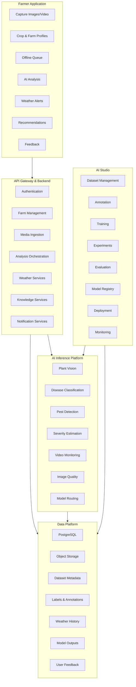

# AgriVision AI — الوثيقة الهندسية التأسيسية (الإصدار 1.0)

**الاسم:** AgriVision AI — المراقب الزراعي الذكي
**الوصف:** منصة ذكاء اصطناعي زراعية متعددة الوسائط للمراقبة والتحليل ودعم القرار الزراعي
**النطاق الجغرافي:** الجمهورية اليمنية
**استراتيجية التشغيل:** Hybrid AI — الهاتف والخادم
**استراتيجية النماذج:** نماذج تشغيل جاهزة + مختبر مستقل للتدريب والتقييم والتحسين
**شكل المنتج:** تطبيق المزارع + مختبر الذكاء الاصطناعي + لوحة الإدارة

---

## 1. الرؤية والأهداف

AgriVision AI منصة زراعية متكاملة تجمع الرؤية الحاسوبية والتعلم العميق وتحليل البيانات والطقس، بهدف مساعدة المزارع والمهندس الزراعي على فهم حالة المحاصيل واتخاذ قرارات مبنية على بيانات وأدلة.

لن تكون المنصة مجرد تطبيق يرفع صورة ورقة نبات ويحصل على اسم مرض؛ بل نظام يجمع عدة أنواع من المعلومات:

- صور النباتات والأوراق والثمار
- صور الحشرات والآفات
- فيديوهات لمراقبة المحاصيل
- نوع المحصول ومرحلة نموه
- الموقع الجغرافي والظروف البيئية
- بيانات الطقس والتغيرات المتوقعة
- سجل المزرعة والملاحظات الزراعية
- بيانات المنتجات والمبيدات وملصقات استخدامها

### الأهداف الرئيسية

1. التعرف على المحاصيل والأعراض والأمراض والآفات ضمن الفئات التي جرى تدريبها والتحقق منها
2. تقدير شدة الأعراض ومتابعة تطورها
3. تحليل الفيديو لمراقبة تغير حالة المحاصيل
4. توفير تنبيهات مرتبطة بمخاطر الطقس، ومنها البرد والصقيع والظروف التي قد تهدد المحصول
5. إنشاء قاعدة معرفة للمبيدات والمنتجات الزراعية وطرق استخدامها وفق المعلومات المعتمدة
6. بناء مختبر مستقل لإعداد البيانات وتدريب النماذج ومقارنتها واعتماد إصداراتها
7. توفير تطبيق عملي للمزارع يعمل جزئيًا دون اتصال بالإنترنت
8. بناء نظام قابل للتوسع ليشمل محاصيل ومناطق زراعية يمنية متعددة

---

## 2. القرارات المعمارية المعتمدة

| المجال | القرار |
|--------|--------|
| المحاصيل | متعددة المحاصيل منذ البداية |
| الجغرافيا | اليمن بالكامل |
| التشغيل | هجين: الهاتف والخادم |
| النماذج | نماذج تشغيل مستقرة ومختبر مستقل للتدريب |
| المنتج | تطبيق المزارع + AI Studio + لوحة الإدارة |

### تفسير القرارات

#### تعدد المحاصيل

سيكون تصميم قاعدة البيانات والنماذج وواجهات المستخدم متعدد المحاصيل منذ البداية.

لكن إطلاق التشخيص سيكون وفق مصفوفة محددة: محصول، مرض أو آفة، نوع الأعراض، ظروف التصوير، ومصدر بيانات موثوق.

> [!IMPORTANT]
> لا يجوز عرض تشخيص لفئة لم يتم تدريب النموذج عليها والتحقق منها.

#### التغطية الجغرافية

سيكون اليمن بالكامل هو النطاق المستهدف، مع تقسيم البيانات والطقس والنتائج حسب المحافظة والمديرية والمنطقة الزراعية.

لن نفترض أن نموذجًا تدرب على ظروف منطقة واحدة يعمل بنفس الدقة في جميع المناطق؛ يجب اختبار التعميم جغرافيًا.

#### التشغيل الهجين

- **الهاتف:** الوظائف الخفيفة التي تحتاج استجابة سريعة أو تشغيلًا دون اتصال
- **الخادم:** النماذج الأكبر والعمليات التي تحتاج موارد حوسبة أو بيانات إضافية
- **التطبيق:** يقرر مسار التنفيذ حسب نوع المهمة وتوفر الإنترنت وقدرات الجهاز وإصدار النموذج

#### المختبر المستقل

لن يتعلم نموذج الإنتاج مباشرة من كل صورة يرفعها المستخدم.

ستمر البيانات بمراحل المراجعة والوسم والتحقق والتدريب والتقييم. ولا ينتقل أي نموذج جديد إلى الإنتاج إلا بعد اجتياز معايير الاعتماد.

---

## 3. ميزة التميز: من Image Classification إلى Context-Aware Agricultural Intelligence

تخيل هذا السيناريو:

المزارع يصور نبات الطماطم، فيكتشف النموذج أعراضًا تشبه مرضًا معينًا. لكن المنصة لا تعتمد على الصورة وحدها.

تجمع المعلومات التالية:
- صورة النبات
- نوع المحصول
- عمر النبات إن توفر
- موقع المزرعة
- الظروف الجوية
- تاريخ ظهور الأعراض
- الإصابات السابقة

ثم تنتج تقريرًا يتضمن الاحتمالات والأدلة والأسئلة التي تحتاج إلى إجابة قبل اقتراح المعالجة.

> [!NOTE]
> لا نحتاج إلى استخدام التعلم العميق في كل وظيفة. بعض المهام الحسابية والتحقق من الجرعات يجب أن تعتمد على قواعد وبيانات موثوقة، وليس على تخمين نموذج لغوي.

---

## 4. المعمارية العامة للنظام

تقسم المنصة إلى أربعة نطاقات رئيسية:

1. **Farmer Application** — تطبيق المزارع
2. **AI Backend Platform** — الخادم ومحركات الذكاء الاصطناعي
3. **AI Training & Research Studio** — مختبر التدريب والبحث
4. **Administration Platform** — إدارة المنصة

### المحركات الأساسية

| المحرك | المهمة | التقنيات |
|--------|--------|----------|
| Plant Vision | الأمراض والأعراض | CNN, Transfer Learning |
| Pest Vision | اكتشاف الحشرات | Object Detection |
| Crop Monitoring | التغيرات عبر الزمن | Video Analysis |
| Weather Intelligence | توقع المخاطر الجوية | Time Series ML |
| Pesticide Engine | قراءة وإدارة بيانات المبيدات | OCR + Rules Engine |
| Decision Support | دمج النتائج والسياق | Fusion + Rules |

---

## 5. التقنيات المقترحة

| المكون | التقنية |
|--------|---------|
| AI Training | Python + PyTorch |
| Computer Vision | OpenCV |
| Image Processing | Albumentations |
| Object Detection | YOLO-family models |
| Experiment Tracking | MLflow |
| Dataset Annotation | CVAT |
| Backend | FastAPI |
| Database | PostgreSQL |
| Image Storage | S3-compatible storage |
| Android | Flutter / Dart |
| Dashboard | React + TypeScript |
| Charts | Recharts |
| Local AI | ONNX Runtime |
| Cloud Deployment | Docker |

---

## 6. المنتجات الثلاثة

### 6.1 AgriVision Farmer
تطبيق المزارع، فحص المحاصيل، التنبيهات، والسجل الزراعي.

### 6.2 AgriVision AI Studio
منصة المؤسسات والباحثين لتدريب النماذج وإدارة البيانات والتقييم.

### 6.3 AgriVision Admin
إدارة المنصة والمستخدمين والمحتوى والعمليات.

---

## 7. بوابة اعتماد المعمارية

قبل إنشاء الملفات، يجب مراجعة واعتماد القرارات التالية:

1. ✅ اعتماد هيكل المستودع Monorepo
2. ✅ اعتماد Flutter للموبايل وFastAPI للخادم وReact للوحة المختبر والإدارة
3. ✅ اعتماد PostgreSQL وObject Storage كطبقة البيانات الأساسية
4. ✅ اعتماد فصل AI Studio عن بيئة تشغيل النماذج
5. ✅ اعتماد سياسة أن بيانات المستخدم لا تدخل التدريب تلقائيًا
6. ✅ اعتماد سياسة عدم نشر نموذج جديد قبل التقييم والموافقة
7. ⬜ اعتماد أول مجموعة محاصيل وفئات تشخيصية قابلة للقياس
8. ⬜ تحديد مصادر البيانات والطقس المحلية التي سنبدأ بالتحقق منها

> [!IMPORTANT]
> **القرار الهندسي المعتمد:** Monorepo في المرحلة الأولى لتسهيل التكامل وتوحيد العقود والاختبارات، مع إبقاء التطبيقات والمحركات مستقلة منطقيًا.
