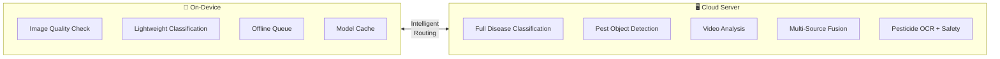
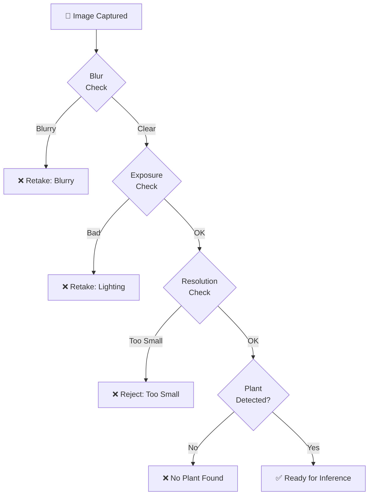
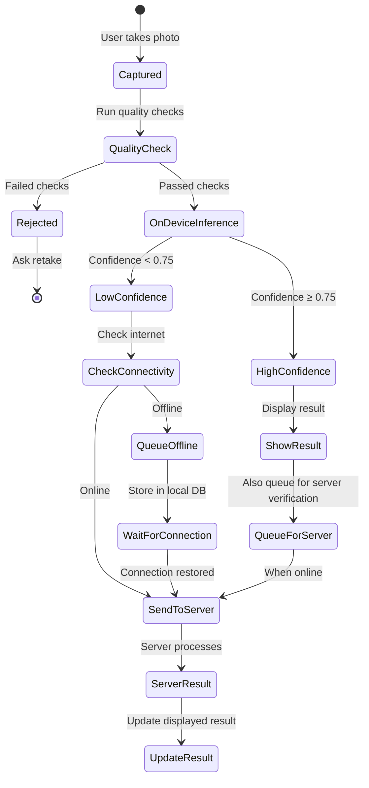
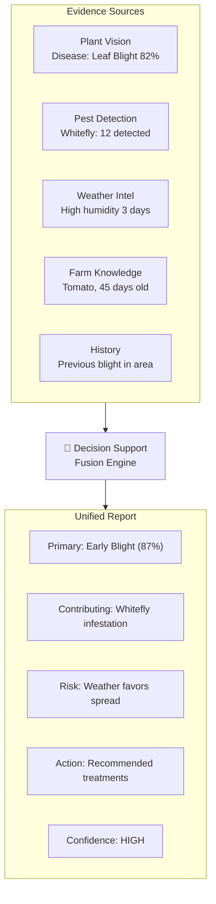
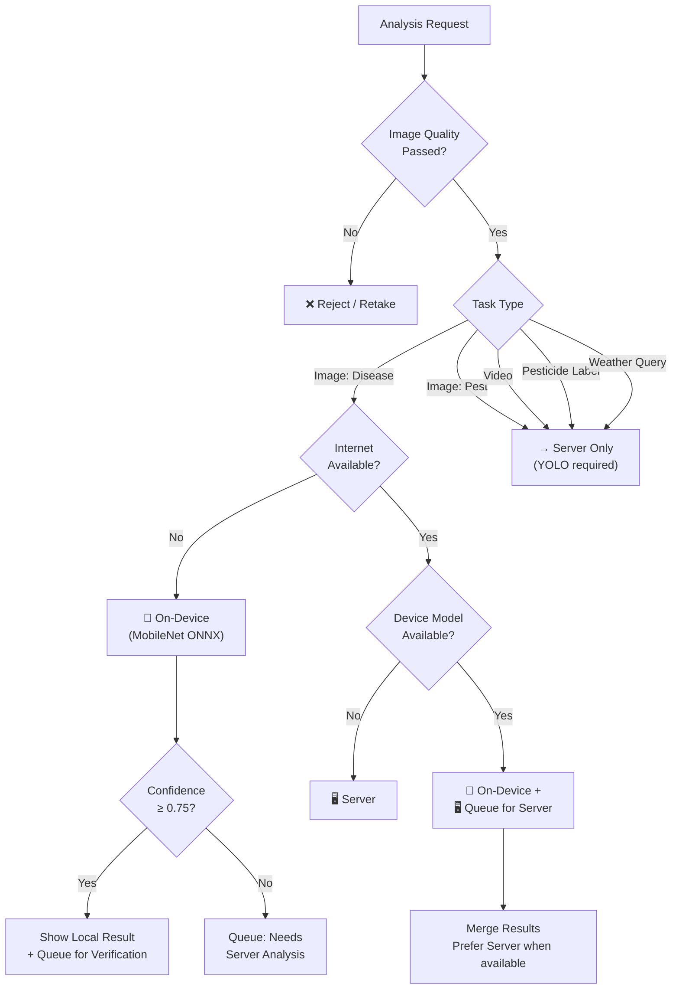
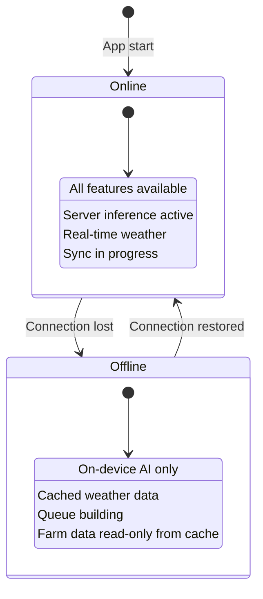
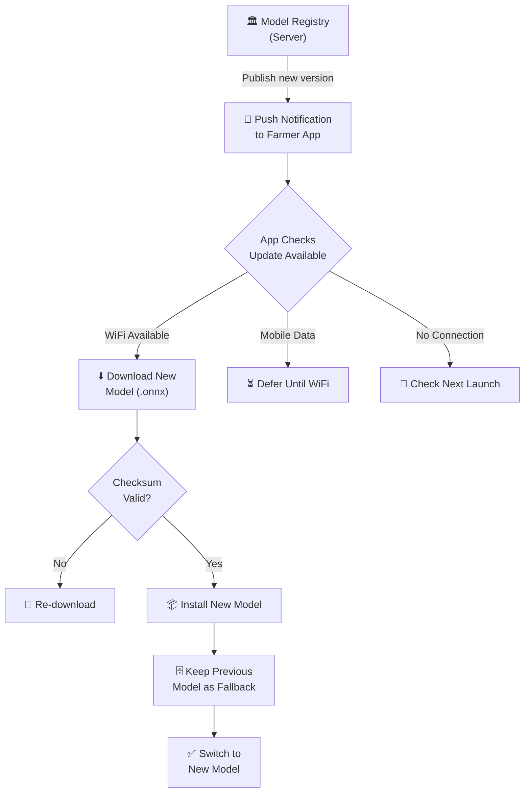

# Hybrid Inference Strategy / استراتيجية الاستدلال الهجين

> **Document Version:** 1.0  
> **Status:** Approved / معتمد  
> **Reference:** [Foundation Document](./foundation-document.md) · [ADR-005](./architecture-decisions.md#adr-005-hybrid-ai-phone--server)

---

## 1. Overview / نظرة عامة

AgriVision AI employs a hybrid inference architecture that distributes AI workloads between the farmer's mobile device and cloud servers. This design addresses Yemen's connectivity challenges while maximizing the quality of AI analysis.

يستخدم نظام AgriVision AI معمارية استدلال هجينة توزع أعباء الذكاء الاصطناعي بين جهاز المزارع المحمول والخوادم السحابية. هذا التصميم يعالج تحديات الاتصال في اليمن مع تحقيق أعلى جودة للتحليل.



---

## 2. On-Device Capabilities / قدرات الجهاز المحمول

### 2.1 Image Quality Check / فحص جودة الصورة

The first line of defense runs entirely on the device before any inference or upload:

| Check | Method | Threshold | Action on Failure |
|-------|--------|-----------|-------------------|
| **Blur detection** | Laplacian variance (OpenCV) | Variance < 100 | Prompt retake: "الصورة ضبابية، يرجى إعادة التصوير" |
| **Exposure check** | Histogram analysis | Mean < 40 or > 220 | Prompt: "الإضاءة غير مناسبة" |
| **Resolution** | Image dimensions | < 224×224 px | Reject: "الصورة صغيرة جداً" |
| **Plant presence** | Lightweight classifier | Confidence < 0.3 | Prompt: "لم يتم اكتشاف نبات في الصورة" |
| **Focus area** | Center crop analysis | Center 50% check | Guide: "ركز الكاميرا على الورقة المصابة" |



### 2.2 Lightweight Classification / التصنيف الخفيف

On-device classification uses optimized MobileNet models converted to ONNX format:

| Parameter | Value |
|-----------|-------|
| **Model architecture** | MobileNetV3-Small |
| **Format** | ONNX (quantized INT8) |
| **Input size** | 224 × 224 × 3 |
| **Model size** | ~5 MB (quantized) |
| **Inference time** | < 200ms on mid-range Android |
| **Runtime** | ONNX Runtime Mobile |
| **Output** | Top-3 disease predictions with confidence scores |
| **Confidence threshold** | ≥ 0.75 for on-device result display |

**Capabilities on device:**
- Crop type identification (preliminary)
- Common disease detection (high-prevalence diseases with sufficient training data)
- Healthy vs. diseased binary classification
- Symptom presence detection (spots, wilting, discoloration)

**Limitations on device:**
- Limited to diseases with > 500 validated training samples
- No bounding box or region segmentation
- No severity estimation (requires higher resolution analysis)
- No cross-referencing with weather or history

### 2.3 Offline Queue / طابور عدم الاتصال

When the device is offline or connectivity is poor, requests are queued locally:



**Offline Queue Schema (SQLite):**

```sql
CREATE TABLE offline_queue (
    id              INTEGER PRIMARY KEY AUTOINCREMENT,
    image_path      TEXT NOT NULL,           -- Local file path
    crop_type       TEXT,                     -- Selected crop
    farm_id         TEXT,                     -- Farm reference
    location_lat    REAL,                     -- GPS latitude
    location_lon    REAL,                     -- GPS longitude
    local_result    TEXT,                     -- On-device JSON result
    local_confidence REAL,                   -- On-device confidence
    metadata        TEXT,                     -- Additional JSON metadata
    created_at      TEXT NOT NULL,            -- ISO 8601 timestamp
    status          TEXT DEFAULT 'PENDING',   -- PENDING, UPLOADING, UPLOADED, FAILED
    retry_count     INTEGER DEFAULT 0,
    last_retry_at   TEXT
);
```

**Queue Processing Rules:**
1. Background sync every 5 minutes when online
2. Prioritize low-confidence results (need server verification)
3. Maximum 3 retries with exponential backoff (5min, 15min, 45min)
4. Images older than 7 days are flagged for user review before upload
5. Maximum queue size: 100 images (oldest PENDING removed with user notice)

---

## 3. Server-Side Capabilities / قدرات الخادم

### 3.1 Full Disease Classification / التصنيف الكامل للأمراض

| Parameter | Value |
|-----------|-------|
| **Model architecture** | EfficientNet-B4 (primary), ResNet-50 (fallback) |
| **Input size** | 380 × 380 × 3 (EfficientNet-B4) |
| **Output** | Full disease taxonomy with confidence, severity estimation, affected region mask |
| **Ensemble** | Optional multi-model voting for ambiguous cases |
| **Latency target** | < 3 seconds per image (including pre/post-processing) |

### 3.2 Pest Object Detection / اكتشاف الآفات

| Parameter | Value |
|-----------|-------|
| **Model** | YOLOv8-Medium |
| **Input size** | 640 × 640 |
| **Output** | Bounding boxes, pest species, count, confidence per detection |
| **NMS threshold** | IoU > 0.5 |
| **Confidence threshold** | > 0.4 per detection |
| **Latency target** | < 2 seconds per image |

### 3.3 Video Analysis / تحليل الفيديو

| Parameter | Value |
|-----------|-------|
| **Frame selection** | Key frame extraction (1 frame per 2 seconds, motion-triggered additional frames) |
| **Analysis** | Per-frame classification + temporal change detection |
| **Segmentation** | Crop health region masks across frames |
| **Output** | Health timeline, change alerts, annotated key frames |
| **Max video length** | 60 seconds |
| **Processing time** | < 30 seconds for 60-second video |

### 3.4 Multi-Source Fusion / دمج المصادر المتعددة

The Decision Support Engine on the server fuses results from all engines:



---

## 4. Routing Decision Logic / منطق قرار التوجيه

The inference router determines where each request is processed:



### Routing Rules Table / جدول قواعد التوجيه

| Task | On-Device | Server | Routing Rule |
|------|-----------|--------|--------------|
| Image quality check | ✅ Always | — | Always on-device first |
| Disease classification | ✅ If model available | ✅ Always when online | On-device immediate + server verification |
| Pest detection | — | ✅ Required | Server only (YOLO) |
| Video analysis | — | ✅ Required | Server only |
| Severity estimation | — | ✅ Required | Server only |
| Weather intelligence | — | ✅ Required | Server only (external data) |
| Pesticide OCR | — | ✅ Required | Server only |
| Decision fusion | — | ✅ Required | Server only (multi-source) |

---

## 5. Offline Mode Behavior / سلوك وضع عدم الاتصال

### State Machine / آلة الحالة



### Feature Availability by Connectivity / توفر الميزات حسب الاتصال

| Feature | Online | Offline | Notes |
|---------|--------|---------|-------|
| Take photo / capture | ✅ | ✅ | Always available |
| Image quality check | ✅ | ✅ | Runs on device |
| Quick disease check | ✅ | ✅ (on-device) | Lower confidence offline |
| Detailed disease analysis | ✅ | ❌ (queued) | Requires server |
| Pest detection | ✅ | ❌ (queued) | Requires server YOLO |
| Video analysis | ✅ | ❌ (queued) | Requires server |
| Weather alerts | ✅ | ⚠️ (cached) | Shows last cached data |
| Pesticide lookup | ✅ | ⚠️ (cached) | Cached knowledge base |
| Farm records (read) | ✅ | ✅ (cached) | Local SQLite cache |
| Farm records (write) | ✅ | ✅ (queued) | Syncs when online |
| Analysis history | ✅ | ✅ (local only) | Local results + cached server results |

### Data Caching Strategy / استراتيجية التخزين المؤقت

| Data Type | Cache Duration | Update Trigger |
|-----------|---------------|----------------|
| On-device AI model | Until new version | Model update notification |
| Weather data | 6 hours | App foreground + timer |
| Crop disease catalog | 7 days | App start if online |
| Pesticide knowledge base | 30 days | Manual or app update |
| Farm & crop records | Real-time sync | Any change |
| Analysis history | Permanent (local) | After server sync |

---

## 6. Model Versioning on Device / إصدارات النماذج على الجهاز

### Version Management / إدارة الإصدارات



### Model Package Format / صيغة حزمة النموذج

Each on-device model is distributed as a versioned package:

```json
{
    "model_id": "plant-vision-mobile-v2",
    "version": "2.1.0",
    "format": "onnx",
    "quantization": "int8",
    "file_size_mb": 4.8,
    "input_shape": [1, 3, 224, 224],
    "output_classes": 23,
    "supported_crops": ["tomato", "grape", "wheat", "coffee"],
    "min_app_version": "1.2.0",
    "min_android_sdk": 24,
    "checksum_sha256": "a1b2c3d4...",
    "published_at": "2024-06-15T10:00:00Z",
    "model_card_url": "/api/v1/models/plant-vision-mobile-v2/card",
    "changelog": [
        "Added coffee disease classes",
        "Improved grape classification accuracy by 5%",
        "Reduced model size by 15%"
    ]
}
```

### Version Policies / سياسات الإصدارات

| Policy | Rule |
|--------|------|
| **Minimum supported version** | Server enforces minimum model version; forces update if too old |
| **Rollback** | Previous model version kept on device; auto-rollback if new model crashes |
| **Download** | WiFi-only by default; user can opt-in to mobile data download |
| **Storage** | Maximum 2 model versions on device (current + previous) |
| **Compatibility** | Model version checked against app version; incompatible models not installed |
| **Forced update** | Critical safety fixes can force immediate model update (with user notice) |

---

## 7. Performance Requirements / متطلبات الأداء

| Metric | On-Device Target | Server Target |
|--------|-----------------|---------------|
| Image quality check | < 100ms | N/A |
| Disease classification | < 200ms | < 3s |
| Pest detection | N/A | < 2s |
| Video analysis (per frame) | N/A | < 500ms |
| Decision fusion | N/A | < 1s |
| Total analysis (end-to-end) | < 500ms (on-device only) | < 10s (full pipeline) |
| Model download | Background | N/A |
| Offline queue sync | < 30s per item | N/A |

---

## 8. Error Handling / معالجة الأخطاء

| Scenario | Behavior |
|----------|----------|
| On-device model missing | Fall back to server-only mode |
| On-device model crash | Catch exception, log, use server |
| Server timeout (>15s) | Return on-device result if available, mark as "unverified" |
| Server error (5xx) | Retry once after 5s, then queue for later |
| Upload failure | Add to offline queue with retry policy |
| Contradictory results (device vs server) | Prefer server result, flag discrepancy for review |
| Both unavailable | Show "unable to analyze" with guidance to retry |

> [!WARNING]
> When on-device and server results contradict, the server result takes precedence. The discrepancy is logged for model improvement. The user is informed: "تم تحديث النتيجة بعد تحليل أعمق من الخادم" (The result has been updated after deeper server analysis).
