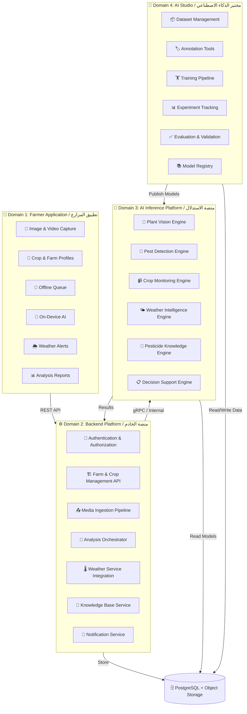
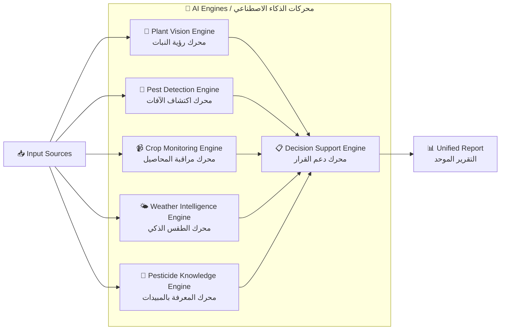
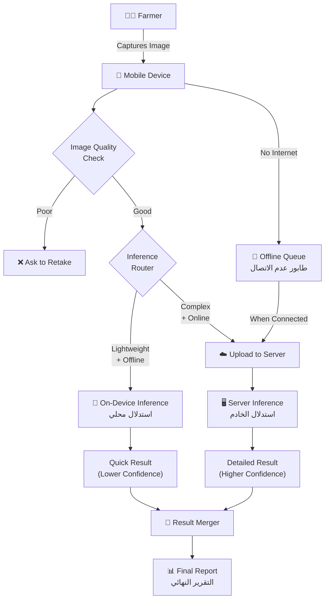
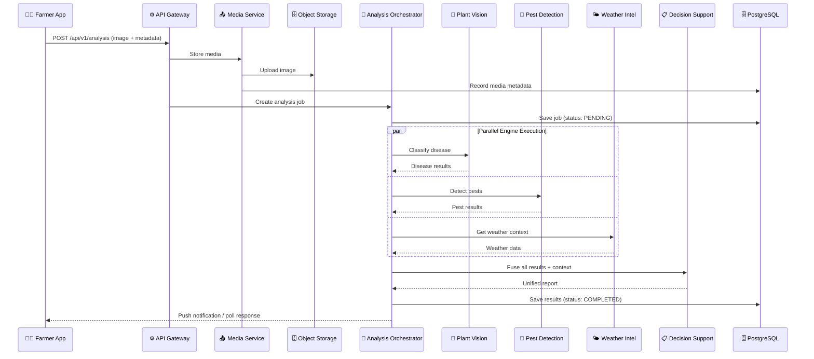
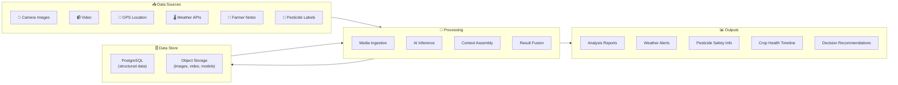
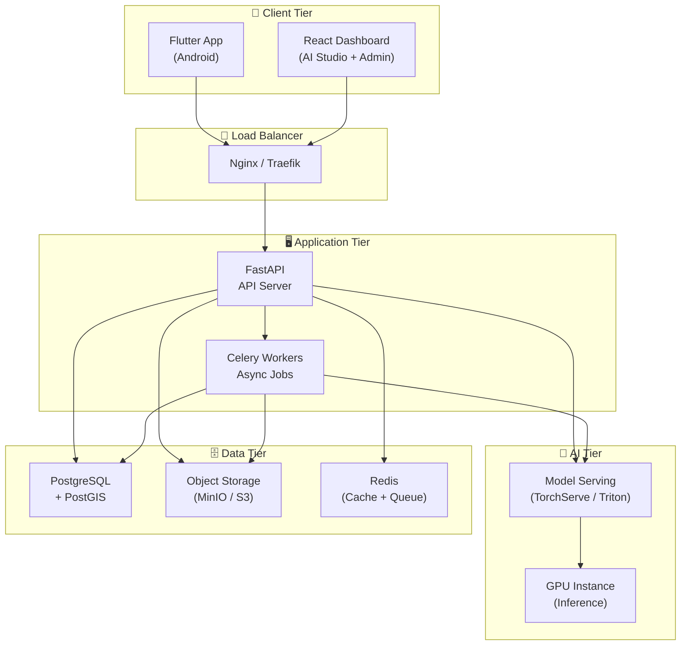

# System Architecture Overview / نظرة عامة على معمارية النظام

> **Document Version:** 1.0  
> **Status:** Approved / معتمد  
> **Reference:** [Foundation Document](./foundation-document.md)

---

## 1. Introduction / مقدمة

AgriVision AI is a multi-modal agricultural intelligence platform designed to help Yemeni farmers and agricultural engineers monitor crop health, detect diseases and pests, and make evidence-based decisions. This document provides a comprehensive overview of the system architecture.

AgriVision AI هي منصة ذكاء اصطناعي زراعية متعددة الوسائط مصممة لمساعدة المزارعين والمهندسين الزراعيين اليمنيين على مراقبة صحة المحاصيل واكتشاف الأمراض والآفات واتخاذ قرارات مبنية على أدلة.

---

## 2. The Four Domains / النطاقات الأربعة الرئيسية

The platform is organized into four major architectural domains:

### Domain Responsibilities / مسؤوليات كل نطاق

| Domain | Arabic Name | Primary Responsibility |
|--------|-------------|----------------------|
| **Farmer Application** | تطبيق المزارع | Mobile client for image capture, farm management, offline operation, results viewing |
| **Backend Platform** | منصة الخادم | API gateway, business logic, orchestration, data persistence, external service integration |
| **AI Inference Platform** | منصة الاستدلال | Model serving, inference execution, result aggregation, confidence scoring |
| **AI Studio** | مختبر الذكاء الاصطناعي | Data curation, model training, experiment tracking, model evaluation and publishing |

---

## 3. The Six AI Engines / محركات الذكاء الاصطناعي الستة

AgriVision AI operates six specialized AI engines, each responsible for a distinct agricultural intelligence capability:

### Engine Specifications / مواصفات المحركات

| Engine | Input | Output | Techniques |
|--------|-------|--------|------------|
| **Plant Vision** | Leaf/fruit images | Disease classification, severity, region mask | CNN (ResNet → EfficientNet → MobileNet), Transfer Learning |
| **Pest Detection** | Field/leaf images | Bounding boxes, pest count, species ID | YOLO-family Object Detection |
| **Crop Monitoring** | Video sequences | Health changes over time, growth tracking | Frame Selection, Segmentation, Temporal Analysis |
| **Weather Intelligence** | Location + time series | Risk alerts (frost, heat, rain) | Time Series ML, Threshold Rules |
| **Pesticide Knowledge** | Label images + text | Active ingredients, dosage, safety period | OCR + Rules Engine + Knowledge Base |
| **Decision Support** | All engine outputs + context | Evidence-based report with confidence | Fusion + Rules + Context Integration |

---

## 4. Hybrid Inference Architecture / المعمارية الهجينة للاستدلال

The system employs a hybrid inference strategy that splits AI workloads between the mobile device and the cloud server:

### On-Device vs Server / على الجهاز مقابل الخادم

| Capability | On-Device (الجهاز) | Server (الخادم) |
|------------|-------------------|-----------------|
| Image quality validation | ✅ | — |
| Lightweight disease classification | ✅ (MobileNet/ONNX) | ✅ (EfficientNet) |
| Pest object detection | — | ✅ (YOLO) |
| Video analysis | — | ✅ |
| Weather intelligence | — | ✅ |
| Pesticide OCR & safety | — | ✅ |
| Decision fusion | — | ✅ |
| Offline operation | ✅ (queued) | — |

---

## 5. Data Flow Architecture / تدفق البيانات

### 5.1 Analysis Request Flow / مسار طلب التحليل

### 5.2 Data Flow Summary / ملخص تدفق البيانات

---

## 6. Technology Stack / مكدس التقنيات

### Core Technologies / التقنيات الأساسية

| Layer | Technology | Purpose |
|-------|-----------|---------|
| **Mobile App** | Flutter / Dart | Cross-platform farmer application |
| **Backend API** | FastAPI (Python) | REST API, orchestration, business logic |
| **Database** | PostgreSQL + PostGIS | Structured data with geographic capabilities |
| **Object Storage** | S3-compatible (MinIO) | Images, videos, model artifacts |
| **AI Training** | PyTorch + torchvision | Model development and training |
| **AI Inference** | ONNX Runtime (device), PyTorch (server) | Model execution |
| **Object Detection** | YOLO-family | Pest detection and localization |
| **Image Processing** | OpenCV + Albumentations | Preprocessing and augmentation |
| **Experiment Tracking** | MLflow | Training runs, metrics, model registry |
| **Annotation** | CVAT | Dataset labeling |
| **Dashboard** | React + TypeScript | AI Studio and Admin UI |
| **Charts** | Recharts | Data visualization |
| **Deployment** | Docker | Containerization |

---

## 7. Communication Patterns / أنماط التواصل

### External Communication (Farmer App ↔ Backend)
- **Protocol:** HTTPS REST API (JSON)
- **Authentication:** JWT tokens
- **File Upload:** Multipart form data with signed URLs
- **Real-time:** Push notifications for completed analyses
- **Offline:** Local SQLite queue with background sync

### Internal Communication (Backend ↔ AI Platform)
- **Protocol:** gRPC or internal HTTP
- **Pattern:** Async job queue (submit → poll/callback)
- **Format:** Protobuf or JSON with binary attachments

### AI Studio Communication
- **Protocol:** HTTPS REST API
- **Authentication:** Role-based (researcher, admin)
- **Long-running:** WebSocket for training progress

---

## 8. Deployment Architecture / معمارية النشر

---

## 9. Scalability Considerations / اعتبارات قابلية التوسع

| Aspect | Strategy |
|--------|----------|
| **Horizontal Scaling** | Stateless API servers behind load balancer |
| **AI Scaling** | Separate GPU instances for inference, auto-scaling based on queue depth |
| **Storage Scaling** | Object storage with CDN for media delivery |
| **Database Scaling** | Read replicas for analytics, connection pooling |
| **Geographic Scaling** | Multi-region crop/disease support from day one |
| **Offline Support** | On-device inference reduces server load in low-connectivity areas |

---

## 10. Cross-Cutting Concerns / الاهتمامات المشتركة

### Security / الأمان
- JWT-based authentication with refresh tokens
- Role-based access control (RBAC)
- Encrypted data at rest and in transit (TLS 1.3)
- Farm location privacy protection

### Monitoring / المراقبة
- Application metrics (latency, error rates, throughput)
- AI model metrics (accuracy drift, confidence distribution)
- Infrastructure metrics (CPU, GPU, memory, disk)
- Alerting on anomalies and SLA violations

### Logging / التسجيل
- Structured JSON logging
- Audit trail for all data access and model decisions
- Request tracing with correlation IDs

### Internationalization / التعريب
- Arabic-first UI with RTL support
- Bilingual API responses where applicable
- Local crop names and agricultural terminology
- Date formatting (Hijri and Gregorian)

---

> [!NOTE]
> This document provides a high-level architectural overview. For detailed specifications, see:
> - [Architecture Decisions](./architecture-decisions.md)
> - [Hybrid Inference Strategy](./hybrid-inference.md)
> - [Data Architecture](./data-architecture.md)
> - [API Design](../api/api-design.md)
> - [AI Engines](../ai/ai-engines.md)
