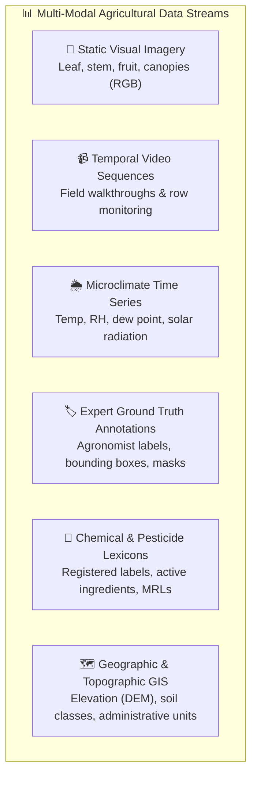
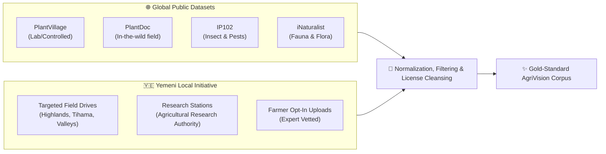
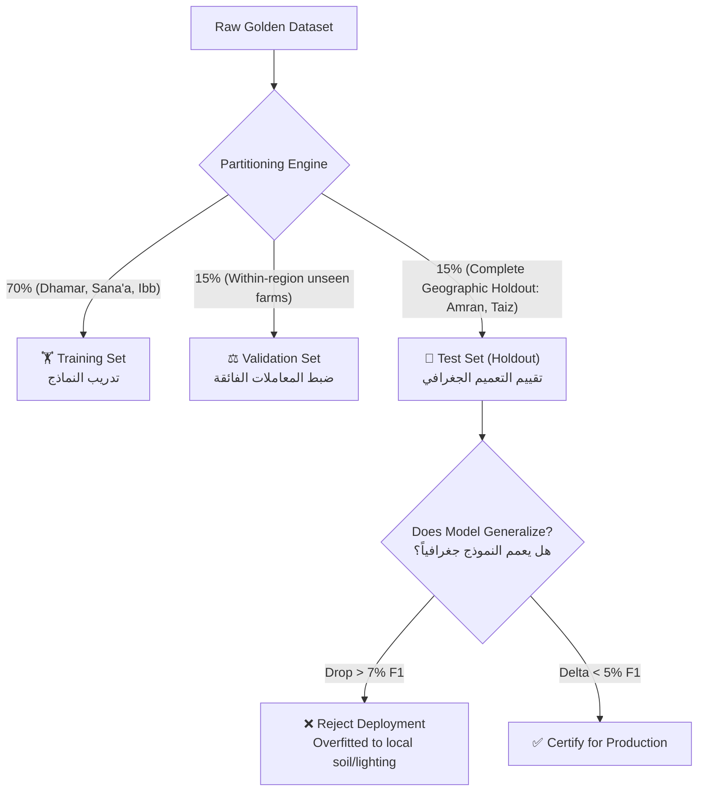

# Data Strategy & Management Plan / استراتيجية البيانات وإدارتها

> **Document Version:** 1.0  
> **Status:** Approved / معتمد  
> **Reference:** [Foundation Document](../architecture/foundation-document.md) · [Data Architecture](../architecture/data-architecture.md)

---

## 1. Executive Vision / الرؤية التنفيذية للبيانات

Data is the fundamental bedrock of AgriVision AI. Recognizing that international computer vision datasets fail to represent the specific agro-climatic conditions, cultivars, and light intensities of Yemen, this strategy outlines the comprehensive protocols for acquiring, curating, annotating, partitioning, and governing agricultural data.

البيانات هي حجر الأساس لمنصة AgriVision AI. نظراً لأن مجموعات البيانات العالمية لا تعكس الأصناف والظروف البيئية وشدة الإضاءة الخاصة باليمن، تحدد هذه الاستراتيجية بروتوكولات جمع البيانات ومعالجتها وتوسيمها وحمايتها وتدقيق تراخيصها.

---

## 2. Multi-Modal Data Typology / تصنيف وأنواع البيانات



### 2.1 Visual Data Streams (RGB Images & Video)
- **High-Resolution Field Imagery:** JPG/PNG format, minimum resolution $1080 \times 1080$ px for research; downsampled dynamically for training.
- **Micro-Insect Macro Imagery:** Close-up imagery of underside leaf veins, whitefly clusters, and stem borers.
- **Walkthrough Video:** MP4 container, H.264/H.265 encoding, 1080p @ 30 FPS, stabilized handheld or gimbal passes.

### 2.2 Environmental & Meteorological Time Series
- Hourly and 15-minute sensor intervals: Dry bulb temperature ($^\circ\text{C}$), wet bulb temperature, relative humidity ($\%RH$), surface leaf wetness duration, precipitation accumulation ($\text{mm}$), barometric pressure ($\text{hPa}$), wind speed and direction.

### 2.3 Agronomic Metadata & Expert Annotations
- Dual-verified diagnostic labels, localized symptom terms, phenological stage markers (BBCH scale), previous cultural interventions.

---

## 3. Data Sources & Integration Strategy / مصادر البيانات واستراتيجية الدمج

To overcome cold-start limitations, AgriVision AI combines curated global scientific benchmarks with our dedicated proprietary Yemeni Field Collection initiative:



### 3.1 Global Public Benchmarks
1. **PlantVillage (54,000+ images):** Used strictly for initial backbone pre-training and basic morphological feature representation. *Note: Disqualified for direct production validation due to artificial uniform lab backgrounds.*
2. **PlantDoc (2,500+ field images):** High-value in-the-wild benchmark reflecting natural occlusion, soil background, and sun glare.
3. **IP102 Large-Scale Pest Dataset (75,000+ images, 102 classes):** Benchmark source for whitefly, aphid, armyworm, and borer detector initialization.
4. **iNaturalist Open Botanical Repositories:** Geo-filtered subsets used for background flora identification and negative-sample mining (preventing false alarms on healthy weeds).

### 3.2 Yemeni Local Field Collection Plan (خطة جمع البيانات المحلية)
- **Phase 1 Target:** 25,000 verified images across priority regions within 9 months.
- **Target Agro-Ecological Zones:**
  - **The Central Highlands (الهضبة الوسطى - صنعاء، ذمار، عمران):** Focus on tomato, potato, grape, and peach diseases + frost stress.
  - **Tihama Coastal Plain (سهل تهامة - الحديدة، حجة):** Focus on mango, cucurbits, cereals, and humid fungal/bacterial blight.
  - **Southern & Western Valleys (الوديان الغربية والجنوبية - إب، تعز):** Focus on coffee (*Coffea arabica*), banana, and fruit leaf spot complexes.
  - **Eastern Plateaus (الهضبة الشرقية - مأرب، حضرموت):** Focus on date palm pests, citrus, and open-field vegetables.

---

## 4. Standardized Sample Metadata Schema / مخطط البيانات الوصفية الموحد

Every visual asset in the AgriVision AI data lake is stored with a rigorous immutable JSON manifest adhering to the following schema:

```json
{
  "$schema": "https://agrivision.ai/schemas/v1/sample-metadata.json",
  "sample_id": "urn:uuid:7c9e6679-7425-40de-944b-e07fc1f90ae7",
  "capture_timestamp": "2024-05-18T08:42:15Z",
  "geographic_context": {
    "country": "YEM",
    "governorate_id": 4,
    "governorate_ar": "ذمار",
    "district_id": 42,
    "district_ar": "عنس",
    "altitude_meters": 2420,
    "agro_climatic_zone": "Highland Plateau",
    "spatial_coordinates": {
      "obfuscated_latitude": 14.542,
      "obfuscated_longitude": 44.381,
      "privacy_grid_precision_km": 1.0
    }
  },
  "crop_metadata": {
    "crop_type_id": 1,
    "crop_name_en": "Tomato",
    "crop_name_ar": "طماطم",
    "cultivar": "Petoseed Super Strain B",
    "phenological_stage": "BBCH 71 (First fruit cluster formed)",
    "plant_tissue_captured": ["leaf_upper", "leaf_lower"]
  },
  "pathology_annotation": {
    "is_healthy": false,
    "primary_diagnosis": {
      "pathogen_id": "DIS-TOM-002",
      "scientific_name": "Alternaria solani",
      "disease_name_en": "Early Blight",
      "disease_name_ar": "اللفحة المبكرة",
      "pathogen_class": "fungal"
    },
    "secondary_diagnosis": null,
    "severity_percentage": 18.5,
    "severity_grade": "Grade 3 (Moderate)"
  },
  "visual_ground_truth": {
    "image_format": "JPEG",
    "dimensions": {"width": 1920, "height": 1080},
    "color_space": "sRGB",
    "annotation_type": "instance_segmentation_polygon",
    "cvat_job_id": "CVAT-TASK-0981",
    "segmentation_mask_s3_uri": "s3://agrivision-gold/masks/2024/05/7c9e6679.png"
  },
  "curation_lifecycle": {
    "source_channel": "field_researcher_drive",
    "collector_id": "USR-AGR-012",
    "verified_by_expert_id": "USR-EXP-004",
    "verification_timestamp": "2024-05-20T14:10:00Z",
    "inter_annotator_agreement_score": 0.94,
    "license": "Proprietary / In-House Closed"
  }
}
```

---

## 5. Train / Validation / Test Partitioning Strategy: Geographic Holdout

A major pitfall in academic computer vision is the naive random splitting of agricultural imagery, which leads to massive data leakage (images of the same leaf or plot ending up in both training and test sets).

AgriVision AI enforces **Stratified Geographic & Temporal Holdout Partitioning**:



### Partitioning Rules:
1. **Zero Spatial Overlap:** All photos taken from a specific farm plot are strictly assigned to either Train, Val, or Test. Never split across subsets.
2. **Geographic Generalization Benchmark:** The Test partition includes whole districts completely absent from the training set, verifying whether the network is memorizing background soil textures or identifying universal biological symptom morphology.
3. **Temporal Partitioning:** A dedicated evaluation test set is reserved from late-season harvests to verify model robustness against changing autumnal lighting and foliage senility.

---

## 6. Privacy, Farmer Consent, and Data Governance

1. **Explicit Opt-In Protocol:**
   - Diagnostic photos uploaded by farmers are processed for inference, but are **never ingested into the AI Studio training pool** without explicit, affirmative toggle consent ("أوافق على مشاركة الصور مجهولة المصدر لأغراض تطوير الذكاء الاصطناعي الزراعي").
2. **Automated Anonymization & EXIF Scrubbing:**
   - Every image ingested into the curation pipeline is scrubbed of EXIF GPS coordinates, camera serial numbers, and device unique identifiers.
3. **Spatial Coordinate Obfuscation:**
   - Farm centroid coordinates are snapped to a coarse 1-kilometer grid before entering any analytical table, guaranteeing that individual farm boundaries cannot be reconstructed.
4. **Facial & PII Censorship:**
   - Automated YOLO pre-filter scans all incoming uploads for human faces or identifiable property markers; images with detected faces are immediately cropped or blurred.

---

## 7. License Verification & IP Cleansing Protocols

| Data Source | Original License | Permitted Commercial Usage | Operational Policy in AgriVision AI |
|---|:---:|:---:|---|
| **PlantVillage** | CC BY-SA 4.0 | ✅ Yes with Attribution | Pre-training backbones only; weights retained, images excluded from final deployment bundle. |
| **PlantDoc** | MIT / Academic | ✅ Yes | Benchmark testing and evaluation suite. |
| **IP102** | Academic Research | ⚠️ Restricted | Prototype testing only; replaced with in-house annotated insect dataset for production release. |
| **iNaturalist** | Mixed (CC0, CC BY, CC BY-NC) | ⚠️ Variable | Strictly filter for CC0 and CC BY; strictly quarantine and reject CC-NC (Non-Commercial) assets. |
| **Yemeni Field Drives**| Proprietary / In-House | ✅ 100% Full Ownership | Core production assets; exclusive property of AgriVision AI. |
