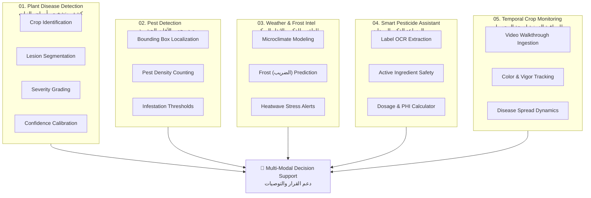
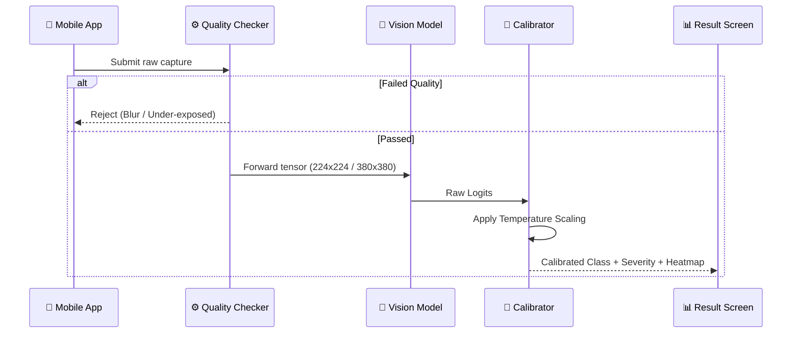
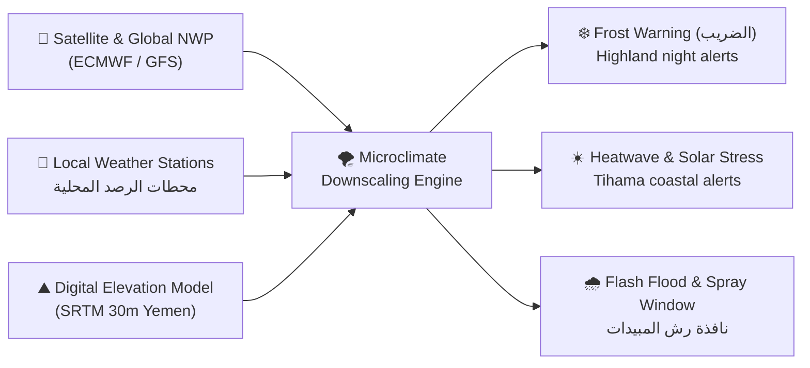
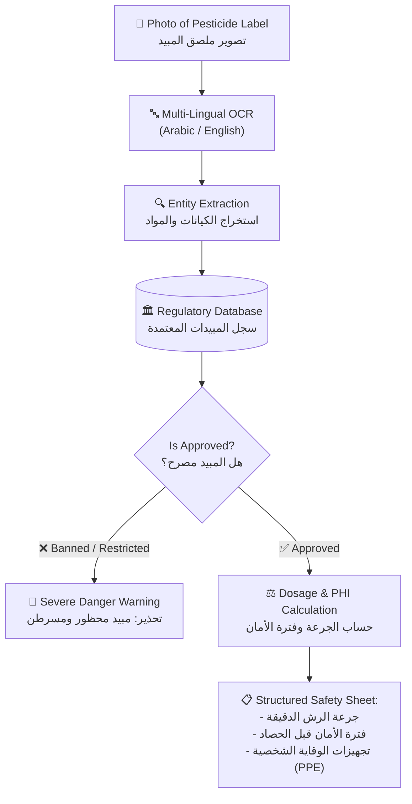

# Core Platform Features Specification / المواصفات التفصيلية للميزات الخمس الأساسية

> **Document Version:** 1.0  
> **Status:** Approved / معتمد  
> **Reference:** [Foundation Document](../architecture/foundation-document.md) · [Product Specification](./product-specification.md)

---

## 1. Feature Landscape Overview / نظرة عامة على الميزات

AgriVision AI delivers five tightly integrated core features that transform standard smartphone hardware into an intelligent agronomic field workstation:



---

## 2. Feature 01: Plant Disease Detection / كشف وتشخيص أمراض النبات

### 2.1 Capability Architecture & Objectives
Provides real-time identification of plant diseases, physiological disorders, and nutritional deficiencies from leaf, stem, or fruit imagery.

### 2.2 Deep-Dive Functional Pipeline
1. **Input Pre-Validation:**
   - Real-time Laplacian variance computation ($\text{Var} > 100$) rejects blurred imagery.
   - Plant presence validation ensures at least 40% of the field of view covers vegetative tissue.
2. **Multi-Stage Classification:**
   - **Stage 1 (Crop Verification):** Confirms if the leaf matches user-selected crop (e.g., Tomato vs. Grape) or auto-detects.
   - **Stage 2 (Health Status):** Binary separation of Healthy vs. Diseased.
   - **Stage 3 (Pathogen Classification):** Specific pathogen discrimination (e.g., Early Blight vs. Late Blight vs. Septoria Leaf Spot vs. Bacterial Spot).
3. **Region Identification & Semantic Localization:**
   - Visual localization produces a Class Activation Map (Grad-CAM++) highlighting specific lesions.
   - Segmented area bounding isolates affected necrosis patches from healthy foliage.
4. **Severity Estimation Grading:**
   - Calculated by:
     $$\text{Severity Index (\%)} = \left( \frac{\text{Pixel Area of Detected Lesions}}{\text{Total Segmented Leaf Blade Area}} \right) \times 100$$
   - Categorized into operational agronomic classes:
     - **Grade 1 (Trace):** $< 5\%$ — Routine monitoring.
     - **Grade 2 (Mild):** $5\% - 15\%$ — Preventative organic / cultural actions.
     - **Grade 3 (Moderate):** $15\% - 35\%$ — Immediate localized treatment.
     - **Grade 4 (Severe):** $> 35\%$ — Systemic intervention or roguing infected plants.
5. **Confidence Scoring & Calibration:**
   - Employs Temperature Scaling to calibrate raw Softmax output into true probabilistic confidence.
   - Displays clear warning when prediction falls below threshold ($\tau < 0.70$).



---

## 3. Feature 02: Pest Detection & Density Estimation / رصد وحصر الآفات الحشرية

### 3.1 Capability Architecture & Objectives
Real-time localization, identification, and numerical density counting of agricultural insect pests, larvae, and egg clusters using high-throughput object detection.

### 3.2 Target Pests in Yemeni Agriculture
- **Tuta absoluta (حفارة أوراق الطماطم)** — Mines and larvae on tomato foliage and fruit.
- **Whiteflies (*Bemisia tabaci* - الذبابة البيضاء)** — Vectors for Tomato Yellow Leaf Curl Virus (TYLCV).
- **Aphids (المن / العسلة)** — Colonies on tender shoots across coffee, grains, and vegetables.
- **Coffee Berry Borer (*Hypothenemus hampei* - خنفساء ثمار البن)** — Perforations in Yemeni green/red coffee berries.
- **Fall Armyworm (*Spodoptera frugiperda* - الحشد الخريفية)** — Maize and sorghum leaf destruction.
- **Red Palm Weevil (*Rhynchophorus ferrugineus* - سوسة النخيل الحمراء)** — Early bore marks on date palms.

### 3.3 Functional Pipeline
1. **Object Detection (YOLOv8-Medium / YOLOv9):**
   - High-resolution processing ($640 \times 640$ up to $1280 \times 1280$ for micro-insects like whiteflies).
   - Generates oriented bounding boxes (OBB) with individual confidence scores ($c_i > 0.40$).
2. **Automated Counting & Density Profiling:**
   - Aggregates individual bounding box occurrences per standard leaf/frame.
   - Calculates density index: Low ($<5$ insects), Moderate ($5 - 20$), Severe ($>20$ insects/leaf).
3. **Economic Injury Level (EIL) Evaluation:**
   - Evaluates whether the pest count has crossed the Economic Threshold (ET) requiring chemical intervention versus natural biological suppression.

---

## 4. Feature 03: Weather & Frost Intelligence / الطقس الزراعي الذكي والإنذار المبكر

### 4.1 Capability Architecture & Objectives
Localized microclimate analytics combined with high-precision temperature, dew point, and humidity forecasting specifically engineered for rugged Yemeni topography (highland valleys, mountain terraces, coastal plains).



### 4.2 The Frost Prediction Engine (محرك كشف الضريب)
- **Context:** Radiation frost in Yemeni mountain governorates (Dhamar, Sana'a, Amran, Sa'dah, Ibb highlands) can wipe out entire tomato, potato, and qat crops in a single night.
- **Prediction Algorithm:**
  - Ingests: Sunset temperature ($T_{\text{sunset}}$), relative humidity ($RH$), dew point ($T_{\text{dew}}$), cloud cover percentage ($C$), and wind speed ($W$).
  - Evaluates cooling rate differential:
    $$T_{\text{min}} = T_{\text{dew}} - \alpha \left(\frac{100 - RH_{\text{sunset}}}{W + 1}\right) \times (1 - C)$$
  - When $T_{\text{min}} \le 2.0^\circ\text{C}$ under clear skies ($C < 20\%$) and calm wind ($W < 2\text{ m/s}$), triggers **Critical Frost Alert** 12 hours ahead.
- **Proactive Mitigation Advisories:**
  - Automated SMS/Push alert sent at 3:00 PM: "تنبيه ضريب حرج الليلة: جهز وسائل الدخان وقم بري الحقل فوراً قبل الغروب لرفع السعة الحرارية للتربة".

### 4.3 Spraying Window Intelligence (نافذة الرش المثالية)
- Computes whether agricultural spray applications will be effective or wasted:
  - **Wind speed check:** Rejects spraying if $W > 15\text{ km/h}$ (drift hazard) or $W < 2\text{ km/h}$ (temperature inversion hazard).
  - **Precipitation check:** Assesses rainfastness (minimum 4 hours of zero precipitation following contact pesticide spray).
  - **Thermal inversion check:** Advises early morning or evening application to avoid photochemical evaporation.

---

## 5. Feature 04: Smart Pesticide Assistant / المساعد الذكي للمبيدات وإدارة الأمان

### 5.1 Capability Architecture & Objectives
A computer vision and regulatory rules engine that reads pesticide container labels, verifies governmental approvals, calculates accurate dosage, and strictly enforces consumer safety withholding periods.



### 5.2 The 4-Stage Pesticide Validation Pipeline
1. **Label Acquisition & Preprocessing:** Adaptive thresholding and perspective rectification to unroll cylindrical bottle geometry.
2. **Entity Recognition & Extraction:**
   - Commercial name matching (e.g., "تيلت", "ريدوميل ذهب", "أفيسكت").
   - Active ingredient matching against international CAS registry (e.g., Propiconazole, Mefenoxam, Thiocyclam).
   - Concentration and formulation type (EC = Emulsifiable Concentrate, WP = Wettable Powder, SC = Suspension Concentrate).
3. **Safety & Regulatory Verification:**
   - Cross-references national banned list (قائمة المبيدات المحظورة والمقيدة بشدة في اليمن - قرار وزاري).
   - Identifies toxicological class based on WHO Classification of Pesticides by Hazard (Class Ia: Extremely Hazardous through Class III: Slightly Hazardous).
4. **Context-Aware Dosage & Pre-Harvest Interval (PHI) Calculation:**
   - Takes farmer's spray equipment volume and land area to compute exact chemical quantity:
     $$\text{Dose Amount} = \text{Target Tank Capacity (L)} \times \text{Prescribed Rate per Liter}$$
   - Displays clear countdown calendar for **PHI (فترة الأمان)** prohibiting harvest until degradation of residues below Maximum Residue Limits (MRL).

---

## 6. Feature 05: Temporal Crop Monitoring / المراقبة الزمنية وتحليل تغير المحاصيل

### 6.1 Capability Architecture & Objectives
Transforms standard smartphone video recordings captured during routine field walkthroughs into an automated spatio-temporal health monitoring system.

### 6.2 Key Operational Capabilities
- **Video Walkthrough Keyframe Extraction:**
  - Downsamples 30/60 FPS video streams to 1 keyframe per 2 meters based on optical flow motion estimation.
  - Automatically discards unstable, ground-facing, or sky-facing frames.
- **Vegetative Vigor & Color Change Analysis:**
  - Evaluates calibrated Green Leaf Index (GLI) and Excess Green Index (ExG) from RGB channels:
    $$\text{GLI} = \frac{2G - R - B}{2G + R + B}$$
  - Detects subtle chlorophyll depletion, nitrogen deficiency, or early viral chlorosis days before macroscopic wilting occurs.
- **Disease & Canopy Spread Dynamics:**
  - Chronological image alignment comparing the same field plot across consecutive weeks ($T_0, T_1, T_2$).
  - Tracks whether pathogen lesions are expanding, stagnating, or receding following curative treatments.
  - Generates interactive temporal slider for the farmer and agronomist.

---

## 7. Multi-Modal Decision Support Synthesis / تكامل دعم القرار

All five features feed their outputs directly into the centralized Decision Support Engine:

```
[Plant Vision: Early Blight (88%)] 
                   + 
[Weather Intel: High humidity & rainfall for 48 hrs] 
                   + 
[Crop Monitoring: Lesions spread +12% since last week] 
                   + 
[Pesticide Assistant: Copper Hydroxide available in stock]
                   ⬇️
       === UNIFIED AGRI-DECISION REPORT ===
  1. Primary Hazard: Rapidly spreading Early Blight outbreak.
  2. Urgent Action: Apply Copper Hydroxide spray within next 18 hours before expected rain.
  3. Strict Instruction: Wear protective mask; Observe 7-day harvest withholding interval.
```
