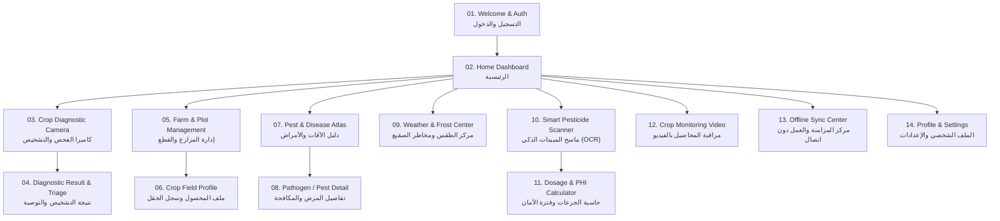
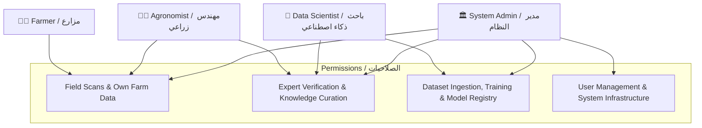

# Product Specification / مواصفات المنتج الشاملة

> **Document Version:** 1.0  
> **Status:** Approved / معتمد  
> **Reference:** [Foundation Document](../architecture/foundation-document.md) · [System Overview](../architecture/system-overview.md)

---

## 1. Executive Summary / الملخص التنفيذي

AgriVision AI is composed of three interconnected products tailored for different stakeholders in the agricultural ecosystem:
1. **AgriVision Farmer App (تطبيق المزارع):** A high-performance, mobile-first, offline-capable application empowering Yemeni growers in the field with instant diagnostics, context-rich recommendations, and climate risk alerts.
2. **AgriVision AI Studio (مختبر الذكاء الاصطناعي):** A specialized workstation for agronomists, data scientists, and researchers to manage datasets, annotate imagery, run training pipelines, evaluate model drift, and register certified model artifacts.
3. **AgriVision Admin Dashboard (لوحة الإدارة المركزية):** Operational control plane for system telemetry, user management, knowledge base curation, and nationwide surveillance of agricultural pest and disease outbreaks.

---

## 2. AgriVision Farmer App: Detailed Screen Specifications / شاشات تطبيق المزارع (14 شاشة)

The mobile application is crafted with Flutter, adhering strictly to Right-to-Left (RTL) Arabic typography, tactile feedback, low-bandwidth optimizations, and high-contrast daylight readability.

### Screen 01: Welcome, Onboarding & Authentication / شاشة الترحيب والدخول
- **Purpose:** Fast, friction-free login optimized for field conditions using mobile numbers.
- **Components:**
  - Phone number input (+967 Yemen telecom prefix auto-detected: You, Sabafon, Yemen Mobile, Y).
  - 4-digit SMS OTP verification with auto-read and fallback voice call verification.
  - Quick onboarding carousel demonstrating offline diagnosis, frost alerts, and pesticide safety.
  - Seamless fallback to local guest mode when offline during first boot.

### Screen 02: Home Dashboard / الشاشة الرئيسية
- **Purpose:** Primary situational awareness hub for the farmer.
- **Components:**
  - **Dynamic Weather & Risk Banner:** Real-time temperature, humidity, and active frost/heat warnings for the selected farm.
  - **Hero Action Button:** Floating high-contrast "فحص المحصول الآن" (Scan Crop Now) triggering camera.
  - **Recent Inspections Carousel:** Card list showing recent crop scans with health status indicators (سليم، مصاب، بحاجة متابعة).
  - **Active Crops Summary:** Quick chips displaying monitored fields (e.g., طماطم - الحقل الشرقي, بن - وادي بني حماد).
  - **Sync Badge:** Floating status icon showing pending offline uploads count.

### Screen 03: Crop Diagnostic Camera / كاميرا الفحص الذكية
- **Purpose:** High-accuracy media capture with real-time on-device feedback.
- **Components:**
  - Full-screen viewfinder with bounding guide box for leaf, stem, or fruit targeting.
  - **Real-Time Quality Overlay:** Instant heuristic badges (إضاءة جيدة / ضعيفة, تركيز واضح / ضبابي, اقترب أكثر).
  - **Crop Selector Dropdown:** Fast switch between registered crops or "كشف تلقائي" (Auto-detect crop).
  - Multi-shot toggle: Capture up to 3 angles (upper leaf, lower leaf underside, general stem).
  - Gallery import button for previously saved pictures.

### Screen 04: Diagnostic Result & Triage / شاشة نتيجة الفحص والتوصيات
- **Purpose:** Clear, actionable, non-cryptic explanation of disease or pest findings.
- **Components:**
  - **Diagnosis Header:** Name of pathogen in Arabic and English (e.g., اللفحة المبكرة / Early Blight - *Alternaria solani*).
  - **Confidence Gauge:** Visual percentage meter with explanatory label (دقة عالية 92% / موثوق).
  - **Visual Evidence:** Annotated photo showing colored heatmaps or bounding boxes pinpointing necrotic lesions.
  - **Severity Assessment:** Multi-level badge (خفيف 10-20%, متوسط 20-50%, حرج >50%).
  - **Immediate Action Steps:** 3 prioritised bullet points for containment.
  - **Feedback Buttons:** "هل التشخيص دقيق؟" (نعم / لا / غير متأكد) feeding into calibration.

### Screen 05: Farm & Plot Management / إدارة المزارع والقطع الزراعية
- **Purpose:** Spatial cataloging of landholdings across Yemeni valleys and terraces.
- **Components:**
  - List of registered farms with location name (المحافظة / المديرية / العزلة).
  - Farm detail card with area (قصبة / لبنة / هكتار - supporting traditional Yemeni land units).
  - Water source indicator (سيل، بئر ارتوازي، غيول، مطري).
  - "إضافة مزرعة جديدة" (Add Farm) modal with simplified GPS coordinate pin dropper.

### Screen 06: Crop Field Profile / ملف المحصول وسجل الحقل
- **Purpose:** Lifecycle health tracker for individual plantings.
- **Components:**
  - Planting metadata: Variety (e.g., طماطم صنف بيتلو، بن عديني، عنب رازقي), planting date, age in days.
  - Current phenological stage tracker (إنبات، نمو خضري، إزهار، عقد، نضج).
  - Chronological timeline of all scans, pesticide treatments, and weather events.
  - Exportable health certificate summary for commercial trading.

### Screen 07: Pest & Disease Atlas / دليل الآفات والأمراض
- **Purpose:** Educational reference encyclopedia accessible completely offline.
- **Components:**
  - Filter by crop (طماطم، بطاطس، بن، عنب، مانجو، حبوب).
  - Filter by pathogen type (فطريات، بكتيريا، فيروسات، آفات حشرية، نقص عناصر).
  - Visual symptom gallery showing typical manifestations across leaf stages.
  - Full-text search supporting local Yemeni dialect names (e.g., الندوة، الهاموش، الجرب).

### Screen 08: Pathogen & Pest Detail / تفاصيل الكائن الممرض والمكافحة
- **Purpose:** Comprehensive deep-dive on a specific agricultural threat.
- **Components:**
  - Biological cycle, causes of outbreak, environmental triggers (درجات الحرارة والرطوبة المثالية لانتشاره).
  - Integrated Pest Management (IPM) guidelines:
    - طرق المكافحة الزراعية والوقائية (Cultural control).
    - طرق المكافحة الميكانيكية والحيوية (Biological control).
    - التدخل الكيميائي كحل أخير (Approved chemical options).

### Screen 09: Weather & Frost Risk Center / مركز الطقس ومخاطر الصقيع (الضريب)
- **Purpose:** Specialized meteorology for Yemeni agro-climatic zones, focusing on highland frost ("الضريب").
- **Components:**
  - 7-day hourly temperature, wind speed, relative humidity, and precipitation forecast.
  - **Frost Risk Engine Widget:** Color-coded risk meter (خطر الصقيع: منعدم / محتمل / وشيك الليلة).
  - Preventive field tips (طرق الدخان، الري الوقائي قبل الغروب، التغطية بالبلاستيك أو القش).
  - Community crowd alerts: Real-time warnings from neighboring farmers in the same valley.

### Screen 10: Smart Pesticide Scanner / ماسح ملصقات المبيدات (OCR)
- **Purpose:** Computer vision extraction of active ingredients and precautions from pesticide packaging.
- **Components:**
  - Live OCR scanner with auto-edge detection targeting commercial labels in Arabic/English.
  - Extraction feedback window displaying:
    - الاسم التجاري (Trade Name).
    - المادة الفعالة ونسبتها (Active Ingredient & Concentration, e.g., Mankozeb 80% WP).
    - رقم التسجيل لدى وزارة الزراعة والري اليمنية (Ministry registration status).
    - رمز السمية وفق منظمة الصحة العالمية (WHO Toxicity Class badge: أحمر، أصفر، أزرق، أخضر).

### Screen 11: Dosage & Safety Calculator / حاسبة الجرعات وفترة الأمان (PHI)
- **Purpose:** Eliminating over-application and ensuring consumer chemical residue safety.
- **Components:**
  - Inputs: Selected crop, target disease, sprayer tank capacity (مضخة ظهرية 16/20 لتر، برميل 200 لتر).
  - Calculated output: Exact chemical quantity in mL or grams to mix per tank.
  - **Pre-Harvest Interval (PHI) Countdown Clock:** فترة الأمان قبل الجني (e.g., "ممنوع جني المحصول قبل مرور 14 يوماً").
  - Re-entry Interval (فترة منع دخول الحقل بعد الرش).

### Screen 12: Crop Monitoring Video Scanner / ماسح مراقبة المحاصيل بالفيديو
- **Purpose:** Continuous row and canopy scanning using handheld video.
- **Components:**
  - Guidance HUD prompting smooth panning velocity across crop rows (سرعة التحريك: مثالية / سريع جداً).
  - Keyframe extraction indicator capturing snapshots every 2 meters.
  - Real-time canopy coverage and vigor color estimation bar.
  - Post-capture submission summary detailing detected anomalies along the walk path.

### Screen 13: Offline Sync Center / مركز المزامنة وإدارة الطابور
- **Purpose:** Transparent management of pending cloud synchronizations under erratic 2G/3G connectivity.
- **Components:**
  - List of pending items: Photos, video segments, farm logs, user feedback.
  - Data transfer mode selector: "المزامنة عبر WiFi فقط" أو "السماح ببيانات الهاتف".
  - Manual "مزامنة الآن" (Sync Now) trigger button.
  - Cache size manager with one-tap cleanup of processed media thumbnails.

### Screen 14: Profile & Application Settings / الملف الشخصي والإعدادات
- **Purpose:** Personalization, localization, and administrative preferences.
- **Components:**
  - Farmer name, verified status badge, primary governorate selection.
  - Unit preferences: Area (هكتار، لبنة، قصبة)، Volume (لتر، جالون)، Temperature (°C).
  - Language toggle (العربية - الافتراضية، English).
  - Offline model cache management (downloading latest offline AI package ~5MB).
  - Terms of service, privacy policy, and data sharing consent toggle.

---

## 3. AgriVision AI Studio: Section Specifications / أقسام مختبر الذكاء الاصطناعي (12 قسماً)

AgriVision AI Studio is an enterprise web application engineered with React 18, TypeScript, and modern data-viz components, built specifically for data engineers and agricultural researchers.

```mermaid
flowchart LR
    subgraph Studio["🔬 AgriVision AI Studio Sections"]
        ST01["01. Project & Workspace"]
        ST02["02. Dataset Ingestion"]
        ST03["03. Image Curation"]
        ST04["04. Annotation (CVAT)"]
        ST05["05. Class Balance & EDA"]
        ST06["06. Training Config"]
        ST07["07. Experiment Tracker"]
        ST08["08. Model Evaluation"]
        ST09["09. Confusion Matrix"]
        ST10["10. Model Registry"]
        ST11["11. Edge Quantization"]
        ST12["12. Deployment Gateway"]
    end
```

### Section 01: Project & Workspace Manager
- Multi-tenant workspace partitioning research initiatives by institution, season, or regional crop programs.
- Granular role delegation (Data Annotator, ML Engineer, Chief Agronomist, Project Director).

### Section 02: Dataset Ingestion & Source Catalog
- Bulk ingestion connectors supporting S3 buckets, local ZIP archives, and external scientific datasets (PlantVillage, PlantDoc, IP102, iNaturalist).
- Ingestion validator checking EXIF stripping, geographic deduplication, image corruptions, and license tags.

### Section 03: Image Curation & Data Cleaning
- Automated quality filter based on blur (Laplacian variance), contrast distribution, and duplicate perceptual hashing (pHash).
- Outlier detection using visual feature embeddings (t-SNE / UMAP clustering of visual embeddings).

### Section 04: Annotation Studio & CVAT Integration
- Embedded CVAT labeling interface supporting classification tags, bounding boxes, polygon masks, and keypoints.
- Pre-annotation inference using staging models to speed up manual polygon segmentation by 4x.
- Dual-annotator review protocol with inter-annotator agreement (Cohen's Kappa) scoring.

### Section 05: Class Balance & Exploratory Data Analysis (EDA)
- Real-time interactive charts illustrating class distribution across crop-disease pairs.
- Geographic representation maps flagging underrepresented Yemeni governorates.
- Imbalance warnings and suggested augmentation factors (Albumentations configs).

### Section 06: Model Training Pipeline Builder
- Visual configuration of PyTorch training runs: Backbone selection (ResNet50, EfficientNet-B0..B7, MobileNetV3, ConvNeXt, YOLOv8).
- Hyperparameter tuning panel: Learning rate schedules (CosineAnnealing, OneCycleLR), optimizers (AdamW, Lion), loss functions (Focal Loss, CrossEntropy with Label Smoothing).
- Dataset split selector: Random, Stratified, or Geographic Holdout validation splits.

### Section 07: Experiment Tracking & MLflow Runs
- Side-by-side run comparisons: Real-time loss curves, validation accuracy, top-1 / top-5 metrics.
- Hardware telemetry: GPU VRAM utilization, training throughput (FPS), tensorboard metric streaming.

### Section 08: Model Evaluation & Performance Deep-Dive
- Comprehensive benchmark reports comparing staging models against historical baselines.
- Granular breakdown: Precision, Recall, F1-Score, PR-AUC, ROC-AUC across individual classes.
- Latency and compute profiling per model architecture (FLOPS, inference time on target ARM chips).

### Section 09: Interactive Confusion Matrix & Error Triage
- Interactive NxN matrix with click-through drilldown: Clicking any false-positive cell instantly displays misclassified imagery.
- Visual explainability inspection: Integrated Grad-CAM, Score-CAM, and Eigen-CAM overlays confirming if network is looking at actual lesions or background soil artifacts.

### Section 10: Model Registry & Artifact Versioning
- Semantic versioning repository (`v1.0.0-rc1`, `v1.2.0-prod`).
- Comprehensive Model Cards auto-generated: Training lineage, data distribution, performance constraints, and intended usage boundaries.
- Approval workflow requiring cryptographic sign-off from both ML Lead and Agricultural Lead.

### Section 11: Edge Quantization & Compression Lab
- Post-training quantization (PTQ) and Quantization-Aware Training (QAT) to INT8 and FP16.
- Model pruning and ONNX export validation ensuring parity between PyTorch FP32 and ONNX INT8 outputs (tolerance $< 0.5\%$ delta).

### Section 12: Deployment & Model Rollout Gateway
- Gated deployment pipeline with canary releasing (e.g., 5% of farmer traffic in Sana'a province).
- Automated generation of mobile update manifests and OTA delta packages.
- Immediate one-click rollback mechanism to the previous known good model version.

---

## 4. Admin Dashboard Sections / أقسام لوحة الإدارة المركزية

The Administrative Portal provides real-time governance, outbreak surveillance, and operational supervision:

| Section | Arabic Name | Key Functionalities |
|---------|-------------|---------------------|
| **National Outbreak Radar** | رادار الأوبئة الزراعية | GIS heatmap tracking surging diseases/pests by governorate; threshold alerts for agricultural authorities. |
| **User & Role Governance** | إدارة المستخدمين والصلاحيات | User account verification, agronomist accreditation, role assignments, audit logs. |
| **Agricultural Knowledge Base** | قاعدة المعرفة الزراعية | Management of approved crop varieties, disease catalogs, pesticide formulations, and regional advisories. |
| **System Telemetry & Health** | المراقبة التقنية والأداء | Real-time API latency, inference queues, GPU cluster health, storage quotas, error crashlytics. |
| **Verification & Moderation** | تدقيق النتائج ومراجعة الشكاوى | Expert triage queue for flagged diagnostic discrepancies and farmer disputes. |
| **Commercial & Billing** | الاشتراكات والفوترة | Subscription tiers, cooperative billing, API key limits, institution quotas. |

---

## 5. User Roles and Permissions Matrix / مصفوفة الأدوار والصلاحيات

| Permission Key | Farmer (مزارع) | Agronomist (مهندس) | ML Researcher (باحث) | Admin (مدير) |
|---|:---:|:---:|:---:|:---:|
| `farm:create_and_manage` | ✅ Own | ✅ Assigned | ❌ | ✅ All |
| `diagnostic:run_inference` | ✅ | ✅ | ✅ | ✅ |
| `diagnostic:verify_expert` | ❌ | ✅ | ❌ | ✅ |
| `knowledge:edit_pesticide_catalog` | ❌ | ✅ | ❌ | ✅ |
| `studio:view_datasets` | ❌ | ✅ | ✅ | ✅ |
| `studio:label_and_annotate` | ❌ | ✅ | ✅ | ✅ |
| `studio:trigger_training` | ❌ | ❌ | ✅ | ✅ |
| `studio:approve_model_prod` | ❌ | ⚠️ Co-sign | ⚠️ Co-sign | ✅ Override |
| `admin:manage_users` | ❌ | ❌ | ❌ | ✅ |
| `admin:view_telemetry` | ❌ | ❌ | ⚠️ Model only | ✅ All |

---

## 6. Arabic Language Support & Cultural Localization / متطلبات التعريب والخصوصية المحلية

1. **RTL Native Layout:** Complete layout inversion across Flutter and Web UIs; all animations, navigations, and swipe gestures respect RTL orientations.
2. **Typography:** Premium Arabic typography utilizing Google Fonts (Noto Sans Arabic and Cairo) with carefully balanced font weights for optimal readability in direct sunlight.
3. **Agricultural Dialect Glossary:** The system supports formal Arabic alongside verified Yemeni regional agricultural vocabulary:
   - *الضريب* instead of just *الصقيع* (Frost).
   - *الندوة* for Blight / Mildew.
   - *العسلة* or *المن* for Aphids.
   - Traditional land measurement conversions: (1 قصبة = 24 ذراع / 1 لبنة = 44.44 م² في صنعاء).
4. **Voice & Audio Accessibility:** Audio playback of diagnosis reports and recommendations for illiterate or semi-literate growers.
5. **Hijri & Gregorian Dual Calendars:** Displaying agricultural planting seasons according to traditional Yemeni agricultural stars (*المعالم الزراعية* like علان، الصلم، سهيل).
