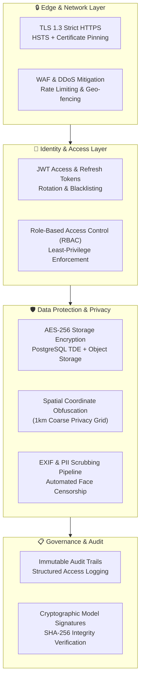
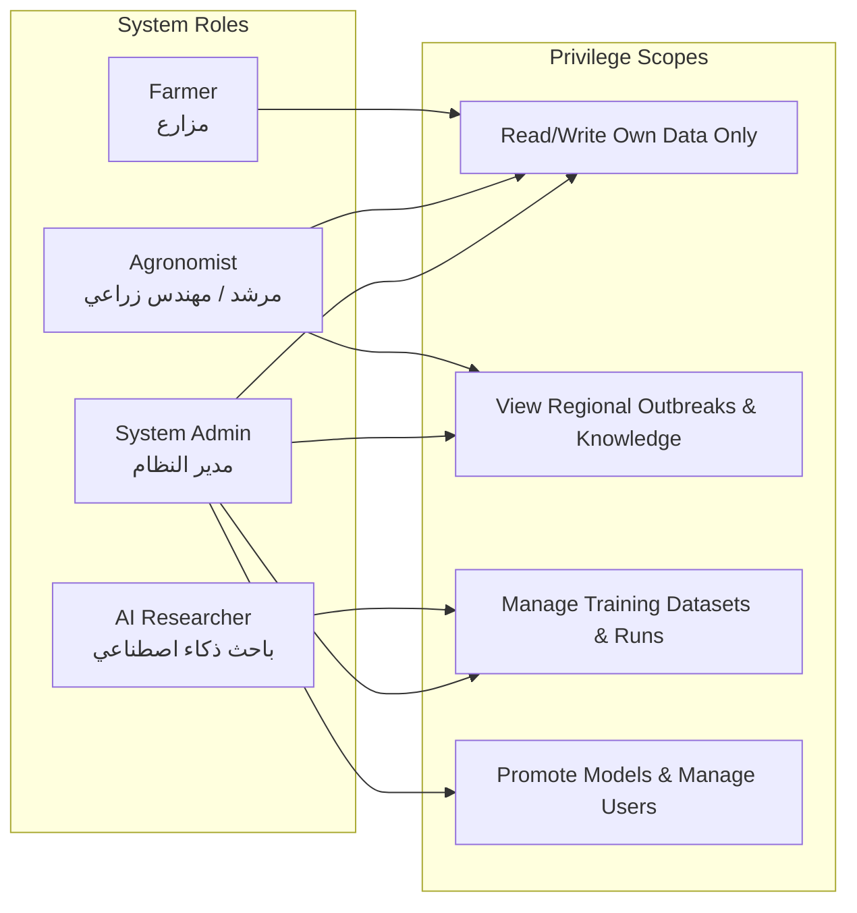
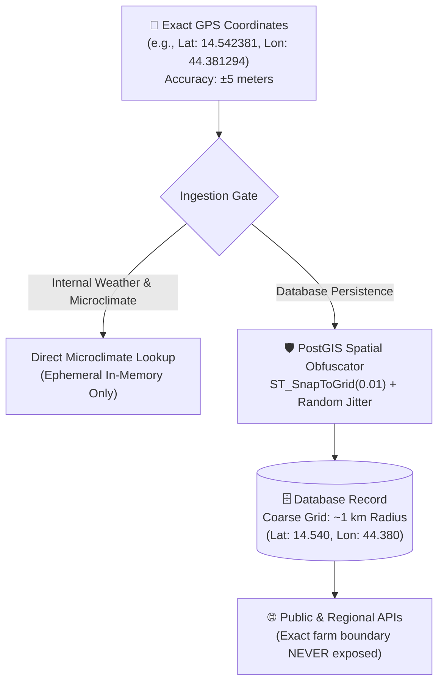
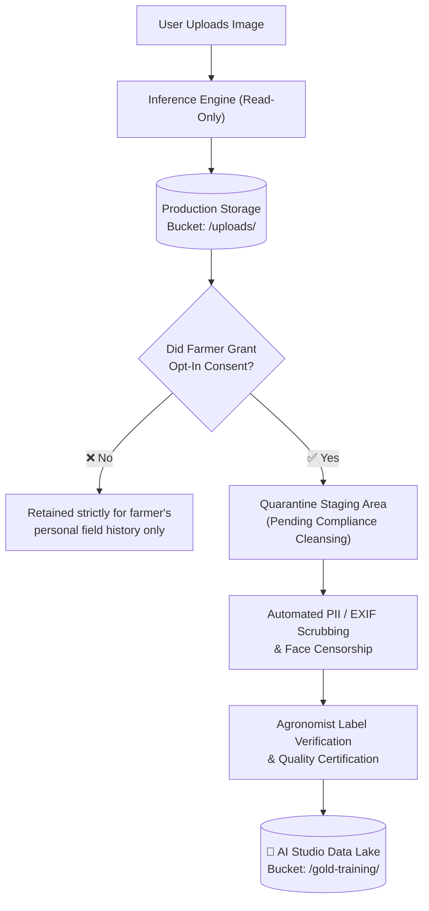

# Security, Privacy & Data Governance / الأمن والخصوصية وحوكمة البيانات

> **Document Version:** 1.0  
> **Status:** Approved / معتمد  
> **Reference:** [Foundation Document](../architecture/foundation-document.md) · [Data Architecture](../architecture/data-architecture.md) · [ADR-006](../architecture/architecture-decisions.md#adr-006-separate-training-from-production)

---

## 1. Executive Security Architecture / المعمارية الأمنية العامة

Security and data confidentiality in AgriVision AI are engineered into every layer of the platform. In agricultural ecosystems, data about crop yields, landholdings, and geographic locations can be commercially sensitive or exploited by unauthorized parties. This document specifies the comprehensive security, encryption, identity, and governance safeguards implemented across the platform.

حماية خصوصية المزارعين وسرية بيانات الأراضي والمحاصيل هي التزام أساسي في منصة AgriVision AI. تحدد هذه الوثيقة متطلبات التشفير، التحكم في الوصول، حماية الموقع الجغرافي، وحوكمة تدفق البيانات.



---

## 2. Encryption Requirements / متطلبات التشفير

### 2.1 Encryption in Transit (التشفير أثناء النقل)
- **Protocols:** Strictly enforced TLS 1.3 (with fallback to TLS 1.2; SSLv3, TLS 1.0, and TLS 1.1 permanently disabled).
- **Cipher Suites:** Forward secrecy mandatory (`ECDHE-ECDSA-AES256-GCM-SHA384`, `ECDHE-RSA-AES128-GCM-SHA256`).
- **HTTP Strict Transport Security (HSTS):** Preloaded with `max-age=63072000; includeSubDomains; preload`.
- **Mobile SSL Pinning:** The Flutter client embeds SHA-256 public key fingerprints for API gateway hosts, preventing Man-in-the-Middle (MITM) attacks on compromised local Wi-Fi or cellular networks.

### 2.2 Encryption at Rest (التشفير أثناء التخزين)
- **Database Storage:** PostgreSQL tablespaces encrypted using AES-256 Transparent Data Encryption (TDE) or underlying LUKS-encrypted NVMe volumes.
- **Object Storage:** MinIO / S3 Server-Side Encryption with Customer-Provided Keys (SSE-C) or KMS-managed keys (SSE-KMS) utilizing AES-256.
- **Client Mobile Cache:** SQLite databases encrypted using SQLCipher; sensitive cryptographic keys stored in Android Keystore / iOS Keychain.

---

## 3. Identity, Authentication & Role-Based Access Control (RBAC)

### 3.1 Token Lifecycle & Authentication
- **Access Tokens:** Short-lived JSON Web Tokens (JWT) signed using asymmetric elliptic curve cryptography (ECDSA with P-256 curve, algorithm `ES256`). Validity period: 15 minutes.
- **Refresh Tokens:** Cryptographically random, single-use refresh tokens stored in Redis with 30-day sliding expiry. Each refresh invalidates the previous token (Refresh Token Rotation).
- **Device Fingerprinting:** Tokens are bound to the client's unique device signature; token usage from an unexpected device fingerprint triggers immediate invalidation and re-authentication challenge.

### 3.2 Granular RBAC Permission Matrix



---

## 4. Farm Location Privacy & Geographic Obfuscation / خصوصية مواقع المزارع

Exact spatial coordinates of private agricultural holdings are highly sensitive. To protect farmers against predatory land speculation, targeting, or unauthorized surveillance, AgriVision AI implements strict coordinate obfuscation:



### Obfuscation Rules:
1. **No Raw Coordinates in Analytical Storage:** Raw sub-meter GPS points are consumed exclusively in ephemeral memory to fetch local elevation and weather station interpolations, and are never written directly to long-term analytical databases.
2. **PostGIS Snap-to-Grid:** Spatial points are quantized to a 1 km grid via:
   $$\text{Obfuscated Point} = \text{ST\_SnapToGrid}(\text{Raw Point}, 0.01)$$
3. **Regional Aggregation:** Public disease outbreak maps display regional heatmaps aggregated at the District (*مديرية*) or Governorate (*محافظة*) level; individual farm centroid markers are strictly masked.

---

## 5. Farmer Consent & Training Data Separation / فصل بيانات التدريب والموافقة

Per **ADR-006**, production user uploads never flow automatically into AI model training. Strict data compartmentalization is enforced:



### Data Sovereignty & Consent Guarantees:
- **Affirmative Opt-In:** The user must explicitly opt in via settings or during scan submission. Default state is strictly opted-out.
- **Right to Erasure (Data Deletion):** Farmers may delete their farm account and associated image archives at any time; all linked production media in S3 are purged within 72 hours.
- **Immutable Training Snapshot Isolation:** Once training datasets are formalized and versioned via DVC, they contain solely scrubbed, non-identifiable biological patches with no link back to the originating user account.

---

## 6. Audit Logging & System Telemetry / سجلات التدقيق والمراقبة

To meet enterprise compliance, every security-relevant event produces an immutable structured audit log:

```json
{
  "event_id": "aud-99120482-1920-4a88",
  "timestamp": "2024-06-12T11:24:00.128Z",
  "actor": {
    "user_id": "usr-admin-002",
    "ip_address": "197.245.12.8",
    "role": "admin"
  },
  "action": "model:promote_to_production",
  "resource": {
    "entity": "model_version",
    "id": "plant-vision-server-v1.4.0",
    "sha256": "8f3b4c12d5..."
  },
  "status": "SUCCESS",
  "metadata": {
    "previous_version": "v1.3.2",
    "approved_by_agronomist": "usr-agr-009"
  }
}
```

### Monitored Audit Events:
- User login failures and suspicious brute-force attempts.
- Changes to user permissions and role assignments.
- Modifications to pesticide regulatory catalogs and banned chemicals lists.
- AI model promotions, weight deployments, and rollback events.
- Bulk export requests of geographic farm metadata.

---

## 7. Model Deployment Security / أمان نشر النماذج

1. **Cryptographic Artifact Signing:**
   - Model weights (`.pt`, `.onnx`) are cryptographically hashed (SHA-256) and signed using an internal private key before being published to the Model Registry.
   - The production serving container verifies the digital signature before loading the weights into GPU VRAM. Tampered or corrupted artifacts fail to load.
2. **Container Security & Hardening:**
   - Model serving runs inside non-root, read-only Docker containers with minimal distroless base images.
   - All network egress from AI inference containers is blocked, preventing exfiltration in the event of zero-day vulnerabilities in ML parsing libraries.
3. **Adversarial Input Sanitization:**
   - Strict image decoding validations in OpenCV prevent buffer overflows and memory poisoning attacks via malformed image file headers.
